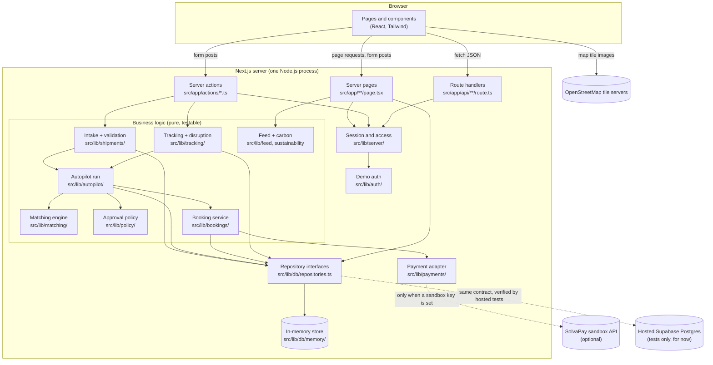
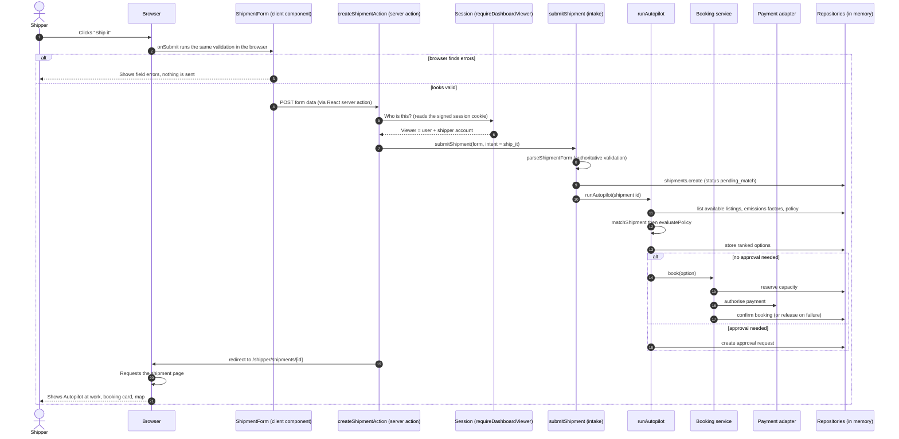
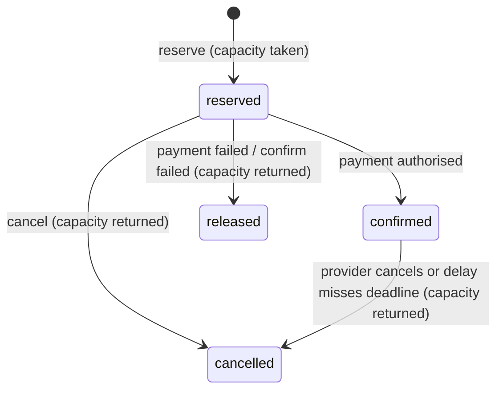
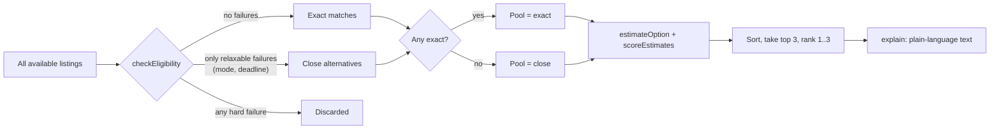
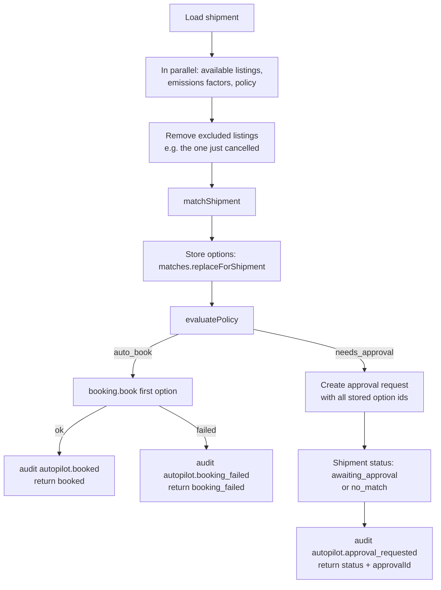
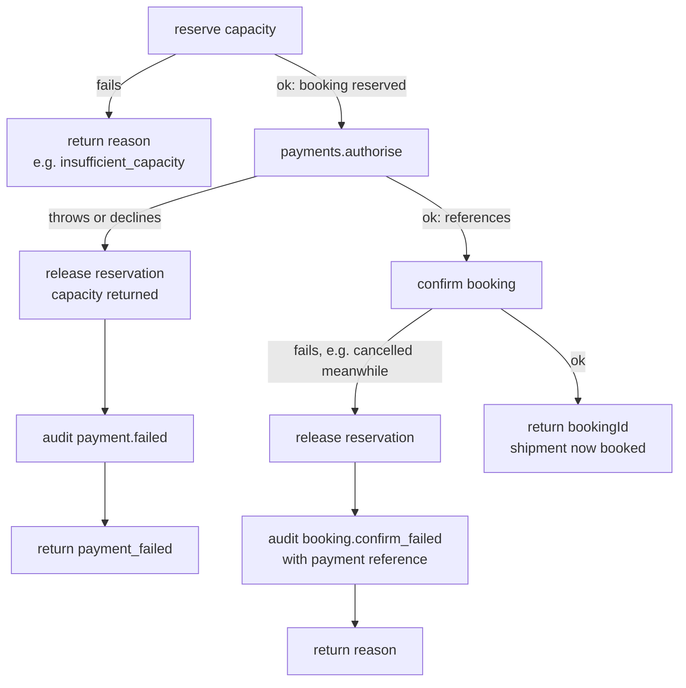
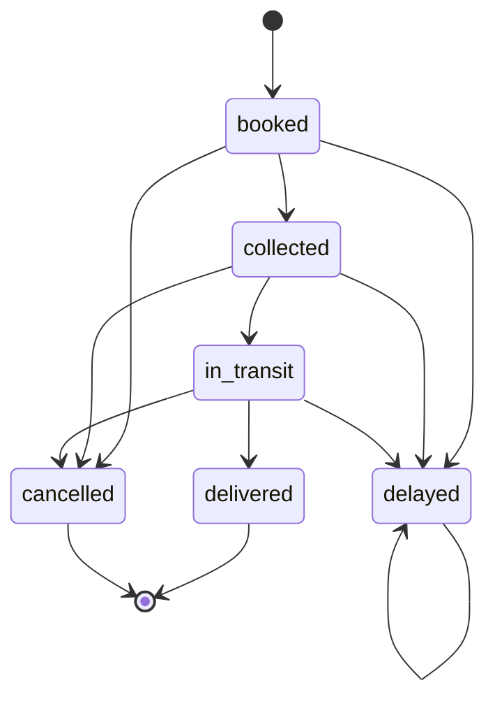
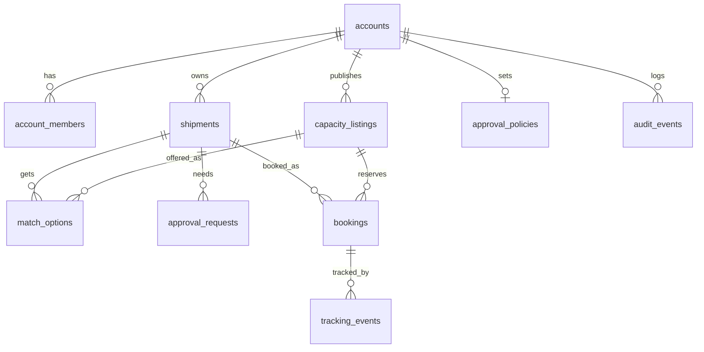

# Learning AutoShip: a beginner's guide to how it works and how to rebuild it

This guide teaches you, from zero, how the AutoShip prototype in this repository works. It assumes you know very little about programming. Every technical term is explained the first time it appears, and every explanation points at the real file that does the work, so you can open it and read along.

By the end you should understand:

- what problem AutoShip solves and for whom;
- how a click in the browser turns into work on a server and back into a page;
- every tool in the stack and why it was chosen;
- every backend rule (matching, scoring, approvals, booking, payments, tracking);
- every screen in the frontend;
- how the project is tested and kept secure;
- and, step by step, how you could rebuild the whole thing from an empty folder.

Everything here describes the branch `demo/showcase-provider`, which is the `main` branch plus a small amount of extra demo data (explained in [section 8.7](#87-branches)). Where something is simulated, unfinished or only partly built, this guide says so plainly.

> **How to read this guide.** Read sections 1 to 3 in order: they give you the vocabulary. After that, sections 4 and 5 can be read in any order, like a reference book. Section 9 is the practical "build it yourself" plan. Section 11 is a glossary you can return to at any time.

---

## Table of contents

1. [What AutoShip is and the problem it solves](#1-what-autoship-is-and-the-problem-it-solves)
2. [The big picture](#2-the-big-picture)
3. [The tools and tech stack, explained from zero](#3-the-tools-and-tech-stack-explained-from-zero)
4. [Backend features](#4-backend-features)
5. [Frontend features](#5-frontend-features)
6. [Security and privacy](#6-security-and-privacy)
7. [Testing](#7-testing)
8. [Running it](#8-running-it)
9. [Rebuild it yourself: a step-by-step roadmap](#9-rebuild-it-yourself-a-step-by-step-roadmap)
10. [Known limitations and ideas for next steps](#10-known-limitations-and-ideas-for-next-steps)
11. [Glossary](#11-glossary)

---

## 1. What AutoShip is and the problem it solves

### 1.1 The problem

Small businesses often need to move goods: a pallet of ceramics to a shop in Manchester, a crate of returned stock back to London, an urgent spare part to Edinburgh. Booking transport is fiddly. You have to find a carrier, check they go where you need, check your item fits, check they arrive in time, compare prices, and then pay.

At the same time, lots of vans, ships and planes travel **partly empty**. A van that delivers to Manchester often drives back to London with nothing in it. That empty space is wasted money for the carrier and wasted carbon dioxide (CO₂) for the planet.

AutoShip connects these two sides. It matches small shipments to spare transport capacity, books the best option automatically when it is safe to do so, and tells you how much CO₂ you saved compared with sending the item in a vehicle of its own.

The product description lives in `docs/spec.md`. Its first sentence sums it up:

> AutoShip helps small businesses move goods by road, sea, or air.

### 1.2 The two kinds of user

AutoShip has two kinds of account (defined in `src/lib/domain/account.ts`):

| Account kind | Who they are | What they do in AutoShip |
| --- | --- | --- |
| **Shipper** | A business or an individual with goods to move. A shipper is either a *business shipper* or an *individual shipper*. | Describes a shipment, lets Autopilot book it (or compares options by hand), approves or declines bookings, sets their approval rules, watches tracking and their carbon meter. |
| **Provider** | A transport company with spare road, sea or air capacity. | Publishes *capacity listings* (for example "Bristol to London, Tuesday, 1,000 kg free"), sees which shipments were booked on their capacity, and posts tracking updates such as "collected" or "delayed". |

### 1.3 Autopilot: the "agent" at the heart of AutoShip

**Autopilot** is the part of AutoShip that acts on the shipper's behalf. When a shipper fills in a shipment and presses **Ship it**, Autopilot:

1. searches every provider listing for ones that can carry the shipment;
2. works out the price, arrival time, spare time before the deadline, and CO₂ for each;
3. ranks them according to what the shipper cares about (cheapest, fastest, lowest carbon, or a balance);
4. checks the shipper's **approval rules** (for example "never spend more than £100 without asking me");
5. either **books and pays automatically**, or **stops and asks the shipper to approve**.

It is called an "agent" because it makes decisions and takes actions (including paying) for you, within limits you set. In this prototype it is not a chatbot or an AI model: it is ordinary, deterministic code (code that always gives the same answer for the same input) in `src/lib/autopilot/run.ts`.

### 1.4 Sustainability

Every option and every booking carries two carbon figures:

- **CO₂** — the estimated emissions for *your share* of a shared vehicle;
- **CO₂ saved** — how much less that is than a *dedicated vehicle* (a van making the trip just for you).

The shipper's dashboard has a **carbon meter** that adds these up for the current month and year and turns them into a score out of 100 (see [section 4.12](#412-sustainability-and-the-carbon-meter)). The emissions factors used are placeholders, clearly labelled "prototype placeholder" in `src/lib/domain/emissions.ts`; they are not official figures.

### 1.5 SolvaPay

**SolvaPay** is a payments service designed for AI agents and software that spends money on someone's behalf. AutoShip uses it so that Autopilot can pay for a booking within limits.

Two important facts, both recorded in the decision record `docs/decisions/0003-solvapay-authorisation-not-escrow.md`:

1. AutoShip uses SolvaPay only to **authorise and take payment** for a booking (in a *sandbox*, a practice environment where no real money moves).
2. SolvaPay is **not an escrow**. Escrow means a third party holds the money until the delivery happens and then pays the provider. AutoShip does *not* do this. The "settle on delivery" and "pay the provider" steps are **simulated** in code and move no money.

By default, when no SolvaPay key is configured, AutoShip uses a pretend payment system called the *testing adapter*. All tests and the standard demo use it. See [section 4.9](#49-payments-adapters).

### 1.6 What is real and what is simulated

Being honest about this from the start will save you confusion later:

| Area | Status in this prototype |
| --- | --- |
| Accounts, sign-up, sign-in | Real code, but a **demo** sign-in stored in server memory (ADR 0004). Not production-grade. |
| Data storage while the app runs | **In memory**: everything disappears when the server restarts. |
| Supabase database schema, security rules, booking functions | **Written and verified** on a hosted Supabase project by special tests, but **the running app does not use Supabase yet**. |
| Transport capacity | Listings created by providers in the app, plus seeded demo data. No real carriers. |
| Routing and distances | Each listing stores a fixed distance typed in by the provider. No route planner. |
| Payment authorisation | Testing adapter by default; optional SolvaPay **sandbox** adapter. |
| Settlement and provider payout | **Simulated**. No money moves. |
| Tracking | Provider-posted statuses plus a **simulated** vehicle position along a straight line. No GPS. |
| Notifications | An in-app feed only. No emails. |
| Map | Real OpenStreetMap map tiles; city coordinates are a fixed list. |

---

## 2. The big picture

### 2.1 Some words you need first

Before the diagram, a few basic ideas.

- **Browser.** The program you use to visit websites (Chrome, Edge, Firefox, Safari). It shows pages and runs small programs inside them.
- **Server.** A program running on a computer that waits for requests and answers them. When you run AutoShip on your laptop, your laptop *is* the server. Think of a server as a restaurant kitchen: customers (browsers) send orders, the kitchen prepares them and sends back plates (web pages or data).
- **Client.** Whatever sends requests to a server. Here, the browser is the client.
- **HTTP request.** The message a browser sends to a server, such as "please give me the page at `/shipper`" (a **GET** request) or "here is a filled-in form" (a **POST** request). The server replies with an **HTTP response**, which has a **status code** (200 means OK, 302 means "go elsewhere", 401 means "you are not signed in", 404 means "not found") and a body (an HTML page, or data).
- **HTML.** The language web pages are written in. CSS styles it; JavaScript makes it interactive.
- **URL / route.** The address of a page, for example `http://localhost:3100/shipper/shipments/abc`. The part after the host (`/shipper/shipments/abc`) is the **path**, and a page at a given path is often called a **route**.
- **localhost.** A special name meaning "this computer". `localhost:3100` means "port 3100 on my own machine". A **port** is a numbered door on a computer; different programs listen on different ports.

### 2.2 Architecture diagram

AutoShip is one program (a Next.js application, explained in [section 3.3](#33-nextjs-16-and-the-app-router)) that contains both the pages you see and the server logic behind them.



The key idea is **layers**:

1. **Pages, actions and route handlers** (in `src/app/`) are the doors into the server.
2. **Session code** (in `src/lib/server/`) works out *who* is asking.
3. **Business logic** (in `src/lib/...`) makes decisions. Most of it is *pure*: it does not touch the database, the clock or the network, which makes it easy to test.
4. **Repositories** (in `src/lib/db/`) are the only code that reads and writes stored data.
5. **Adapters** (payments) talk to the outside world, and can be swapped for fakes.

### 2.3 How a request flows: pressing "Ship it"

Here is what happens, step by step, when a signed-in shipper fills in the shipment form and presses **Ship it**.



Notice that validation happens **twice**: once in the browser for quick feedback, and once on the server, which is the one that counts. You can never trust the browser, because anyone can send any data to a server.

### 2.4 Folder map

Here is the repository, with what lives where. Folders are in **bold**.

| Path | What lives there |
| --- | --- |
| `README.md` | Setup, commands, SolvaPay setup, live demo script, demo accounts. |
| `AGENTS.md`, `CLAUDE.md`, `CODEX.md` | Working rules for the AI coding agents that built the project (Codex planned, Claude Code implemented). |
| `package.json`, `package-lock.json` | The project's name, scripts (commands) and dependencies (libraries). |
| `tsconfig.json` | TypeScript settings, including the `@/` shortcut for `src/`. |
| `next.config.ts` | Next.js settings (strict React mode, hide the "powered by" header). |
| `postcss.config.mjs` | Plugs Tailwind CSS into the CSS build. |
| `eslint.config.mjs` | Code-style and bug-pattern checks. |
| `vitest.config.ts` | Test runner settings: four test "projects". |
| `.env.example` | The *names* of environment variables, with blank values. |
| `.gitignore` | Files Git must never track (including `.env.local`). |
| `START.bat`, `STOP.bat` | Windows double-click scripts to start and stop the app on port 3100. |
| **`docs/`** | Spec, architecture, task board, handoff notes, decision records (`docs/decisions/`). |
| **`src/app/`** | Next.js routes: pages (`page.tsx`), the root layout, server actions (`actions/`), JSON route handlers (`api/`). |
| **`src/components/`** | React components: header, theme toggle, auth forms, dashboards, shipment cards, tracking map, provider forms. |
| **`src/lib/domain/`** | TypeScript types describing every kind of record (shipment, listing, booking…). |
| **`src/lib/db/`** | Repository interfaces, the in-memory implementation (`memory/`), and the Supabase reservation adapter (`supabase/`). |
| **`src/lib/auth/`** | Demo sign-up and sign-in: roles, validation, password hashing, session tokens. |
| **`src/lib/server/`** | Server-only glue: app context, services, session cookie, account-scoped data access, demo reset. |
| **`src/lib/shipments/`** | Shipment form validation and intake. |
| **`src/lib/matching/`** | Eligibility, estimate (price, CO₂, margin), scoring, ranking, explanation text. |
| **`src/lib/policy/`** | Approval rules and the settings-form parser. |
| **`src/lib/autopilot/`** | The Autopilot run, and the narration used by the animation. |
| **`src/lib/bookings/`** | Reserve, pay, confirm or release; approval decisions. |
| **`src/lib/payments/`** | Payment adapters: testing and SolvaPay sandbox. |
| **`src/lib/tracking/`** | Status rules, disruption re-matching, simulated position, place coordinates, map maths. |
| **`src/lib/feed/`** | Turns audit and tracking events into the shipper's message feed. |
| **`src/lib/sustainability/`** | Carbon meter maths. |
| **`src/lib/providers/`** | Listing form validation and provider operations. |
| **`src/lib/demo/`** | Scripted demo dataset, the seed routine, and the showcase provider. |
| **`src/lib/theme/`** | Light/dark theme storage and the no-flash start-up script. |
| **`supabase/`** | Supabase CLI config and SQL migrations (schema, security, functions). |
| **`tests/`** | Unit tests, local integration tests, hosted Supabase tests, shared contract tests, fixtures. |

> **Note.** `docs/architecture.md` mentions folders called `src/features/` and `src/lib/integrations/`. They do not exist in the code; that work ended up in `src/components/`, `src/lib/payments/` and the other `src/lib/` folders listed above.

---

## 3. The tools and tech stack, explained from zero

This section explains every tool, starting from nothing. Versions come from `package.json`.

### 3.1 Node.js and npm

**JavaScript** is the programming language that web browsers run. **Node.js** is a program that lets JavaScript run *outside* a browser, on a computer, so you can write servers in it. AutoShip's server is a Node.js program. `package.json` says it needs Node `>=20.9.0`; the README notes that the test tools need Node 22.12 or newer, and that the project was checked on Node 26.

**npm** (Node Package Manager) comes with Node.js. It does two jobs:

1. **Installs libraries.** A **library** (or **package**, or **dependency**) is code someone else wrote that you reuse. `npm install` reads `package.json`, downloads every listed library into a folder called `node_modules/`, and records the exact versions in `package-lock.json` so everyone gets the same ones.
2. **Runs scripts.** `package.json` has a `scripts` section, a list of named commands:

```json
"scripts": {
  "dev": "next dev",
  "build": "next build --webpack",
  "start": "next start",
  "lint": "eslint .",
  "typecheck": "tsc --noEmit",
  "test": "vitest run --project unit --project app",
  "test:watch": "vitest --project unit --project app",
  "test:integration": "vitest run --project integration",
  "db:verify": "vitest run --project db"
}
```

So `npm run dev` runs `next dev`, `npm test` runs the tests, and so on.

`dependencies` are libraries the app needs to run (Next.js, React, the Supabase client). `devDependencies` are only needed while developing (TypeScript, Tailwind, Vitest, ESLint, the Supabase command-line tool).

> **Windows tip from the README.** If PowerShell says "running scripts is disabled", use `npm.cmd` and `npx.cmd` instead of `npm` and `npx`.

### 3.2 TypeScript

**TypeScript** is JavaScript with **types** added. A **type** describes the *shape* of a value: "this is a number", "this is a string", "this is an object with a `weightKg` number and a `description` string". The TypeScript compiler (`tsc`) checks your code *before* it runs and complains if you, say, pass a word where a number is expected.

Here is a real type from `src/lib/domain/common.ts`:

```ts
/** Money is stored as integer pence (GBP) to avoid floating-point rounding. */
export type Pence = number;

export const TRANSPORT_MODES = ["road", "sea", "air"] as const;
export type TransportMode = (typeof TRANSPORT_MODES)[number];

export type ModePreference = TransportMode | "any";
```

Things to notice:

- `type Pence = number` gives a meaningful name to a plain number.
- `TransportMode` can only be `"road"`, `"sea"` or `"air"`. Writing `"boat"` would be a compile error.
- The `|` symbol means "or": a `ModePreference` is a transport mode *or* `"any"`. This is called a **union type**.

A common TypeScript pattern in AutoShip is the **result type**, which forces you to handle failure:

```ts
export type ReservationResult = { ok: true; booking: Booking } | { ok: false; reason: ReservationFailure };
```

Code that receives this must check `result.ok` before it can use `result.booking`. TypeScript will not let you forget.

Other words you will see:

- **interface**: another way of describing an object's shape, often used for "a thing that has these methods" (for example `ShipmentRepository`).
- **`async` / `await` / `Promise`**: some operations take time (reading a database, calling an API). An `async` function returns a **Promise**, a placeholder for a value that will arrive later. `await` pauses until it arrives.
- **`as const`**: tells TypeScript to treat a list as fixed, exact values.

`npm run typecheck` runs `tsc --noEmit`, which checks types without producing output files. `tsconfig.json` turns on `strict` mode (the strictest checks) and defines the alias `@/*` → `./src/*`, so `import { matchShipment } from "@/lib/matching/match"` means `src/lib/matching/match.ts`.

### 3.3 Next.js 16 and the App Router

**React** (next section) builds user interfaces. **Next.js** is a **framework** built on React: a framework is a larger structure that decides how your project is organised and gives you a server, routing, building and more. AutoShip uses **Next.js 16.4.6**.

> `AGENTS.md` warns that this Next.js version has breaking changes compared with older versions. For example, a page's `params` is now a Promise you must `await`. If you rebuild this, read the docs bundled at `node_modules/next/dist/docs/`.

#### The App Router: folders become URLs

Next.js's **App Router** turns folders under `src/app/` into URLs. A file called `page.tsx` inside a folder is the page for that URL.

| File | URL |
| --- | --- |
| `src/app/page.tsx` | `/` |
| `src/app/signin/page.tsx` | `/signin` |
| `src/app/signup/page.tsx` | `/signup` |
| `src/app/signup/[role]/page.tsx` | `/signup/business-shipper`, `/signup/provider`, … |
| `src/app/shipper/page.tsx` | `/shipper` |
| `src/app/shipper/shipments/[id]/page.tsx` | `/shipper/shipments/<any id>` |
| `src/app/provider/page.tsx` | `/provider` |

A folder name in square brackets, like `[id]`, is a **dynamic segment**: it matches any value, and the page receives it as a parameter.

#### Layouts

A `layout.tsx` file wraps every page beneath it. `src/app/layout.tsx` is the **root layout**: it produces the `<html>` and `<body>` tags, the theme script, the animated background and the site header, and then places the current page (`children`) inside a `<main>` element. Every page in AutoShip shares this frame.

#### Server components and client components

This is the most important Next.js idea to understand.

- A **React component** is a function that returns a piece of user interface (more in [3.4](#34-react)).
- A **server component** runs **only on the server**. It can read data directly (call repositories, read cookies) and sends finished HTML to the browser. Its code never reaches the browser. In the App Router, **every component is a server component by default**.
- A **client component** starts with the line `"use client"`. Its code is sent to the browser so it can respond to clicks, keep state, run timers and so on. It is still pre-rendered on the server once, then "**hydrated**" in the browser (React attaches its event handlers to the existing HTML).

Analogy: a server component is a printed letter delivered to your door; a client component is a little machine delivered with instructions so it can keep working in your house.

In AutoShip:

- `src/app/shipper/page.tsx` is a server component: it reads the viewer, the shipments and the feed on the server.
- `src/components/shipper/shipment-form.tsx` is a client component (`"use client"`): it needs to run validation as you submit.
- `src/components/shipments/agent-workflow.tsx` is a client component: it runs a timer for the animation.
- `src/components/tracking/route-map.tsx` is a client component: it handles dragging and zooming.

A server component can *contain* client components and pass them data. AutoShip uses this a lot: the shipper page (server) passes the form (client) into the dashboard as a "slot".

#### Server actions

A **server action** (Next.js also calls them **Server Functions**) is a function marked with `"use server"` that runs on the server but can be called from a form in the browser. You attach it to a form, and when the form is submitted, Next.js sends the form data to the server, runs the function, and gives the result back. You do not have to write any request code yourself.

All of AutoShip's server actions are in `src/app/actions/`:

| File | Actions |
| --- | --- |
| `auth.ts` | `signUpAction`, `signInAction`, `signOutAction` |
| `shipments.ts` | `createShipmentAction`, `savePolicyAction` |
| `approvals.ts` | `approveAction`, `declineAction`, `bookOptionAction` |
| `provider.ts` | `createListingAction`, `updateListingAction`, `setListingStatusAction` |
| `tracking.ts` | `postTrackingStatusAction` |

Two helper functions show up often inside actions:

- `redirect(path)` sends the browser to another page (for example to the new shipment page after Ship it).
- `revalidatePath(path)` tells Next.js "the data on this page has changed; render it fresh next time".

#### Route handlers

A **route handler** is a file called `route.ts` that answers HTTP requests with data instead of a page. You export functions named after HTTP methods (`GET`, `POST`). AutoShip has:

| File | Method and purpose |
| --- | --- |
| `src/app/api/shipments/route.ts` | `GET` the signed-in account's shipments as JSON. |
| `src/app/api/shipments/[id]/route.ts` | `GET` one shipment (404 if it is not yours). |
| `src/app/api/bookings/route.ts` | `GET` bookings where you are the shipper or provider. |
| `src/app/api/bookings/[id]/route.ts` | `GET` one booking. |
| `src/app/api/demo/reset/route.ts` | `POST` resets the demo data; `GET` lists demo accounts (development only). |

**JSON** (JavaScript Object Notation) is a text format for data, like `{"error": "unauthorised"}`.

### 3.4 React

**React** (version 19 here) is a library for building user interfaces out of **components**. A component is a function that takes **props** (inputs) and returns **JSX**, which looks like HTML inside JavaScript.

A tiny real example, `src/components/auth/auth-card.tsx`, simplified:

```tsx
export function AuthCard({ title, subtitle, children }: { title: string; subtitle?: string; children: React.ReactNode }) {
  return (
    <div className="rise-in mx-auto w-full max-w-md space-y-6">
      <h1 className="text-2xl font-semibold">{title}</h1>
      {subtitle ? <p className="text-sm text-ink-muted">{subtitle}</p> : null}
      <div className="glass rounded-2xl border border-line p-6">{children}</div>
    </div>
  );
}
```

- `{title}` inserts a value.
- `children` is whatever you put between `<AuthCard>` and `</AuthCard>`.
- `className` sets CSS classes (Tailwind utilities, see 3.5).

React **hooks** are special functions (their names start with `use`) that give components abilities. The ones AutoShip uses:

| Hook | What it does | Where |
| --- | --- | --- |
| `useState` | Remembers a value between renders, such as the animation tick. | `agent-workflow.tsx`, `route-map.tsx`, `reset-demo-button.tsx` |
| `useEffect` | Runs code after the component appears (start a timer, observe size) and cleans up when it disappears. | `agent-workflow.tsx`, `route-map.tsx`, `background-field.tsx` |
| `useRef` | Holds a value or a reference to a page element without causing re-renders. | `route-map.tsx`, `background-field.tsx` |
| `useActionState` | Connects a form to a server action and gives you the action's last result plus a "pending" flag. | every form |
| `useSyncExternalStore` | Reads a value that lives outside React (here: whether `<html>` has the `dark` class). | `theme-toggle.tsx` |
| `cache` (from React) | Remembers a function's result for the duration of one server request. | `src/lib/server/session.ts` |

A **key** is a special prop that tells React which item is which in a list. If a component's key changes, React throws it away and builds a brand-new one. AutoShip uses this trick for the **Replay** button (section 5.5.1).

### 3.5 Tailwind CSS v4, theme tokens and dark mode

**CSS** (Cascading Style Sheets) controls how HTML looks: colours, spacing, fonts. **Tailwind CSS** is a tool that gives you thousands of tiny ready-made CSS classes, such as `p-5` (padding), `rounded-xl` (rounded corners) or `text-sm` (small text), that you combine directly in `className`. You rarely write separate CSS files.

AutoShip uses **Tailwind v4**. It plugs into the build through **PostCSS** (a tool that processes CSS), configured in `postcss.config.mjs` with the `@tailwindcss/postcss` plugin. All styling configuration is in one file, `src/app/globals.css`.

#### Theme tokens

A **token** (or **CSS custom property** / **CSS variable**) is a named value such as `--brand: #0c3b2e`. AutoShip defines its palette as tokens on `:root` (the whole page) and redefines them for dark mode on `.dark`:

```css
:root {
  --background: #ffffff;
  --ink: #0a0a0a;
  --ink-muted: #525252; /* 7.8:1 on white */
  --brand: #0c3b2e; /* forest, 12.5:1 on white */
}

.dark {
  --background: #000000;
  --ink: #f5f5f5;
  --brand: #6d9773; /* sage, 6.3:1 on black */
}
```

The comments record **contrast ratios** (how readable text is against its background; WCAG AA, an accessibility standard, asks for at least 4.5:1 for normal text).

Then an `@theme inline` block tells Tailwind to create colour utilities from these tokens, for example `--color-brand: var(--brand)`. That is why the code can say `bg-brand`, `text-ink-muted` or `border-line`, and the colour automatically changes in dark mode.

The palette is black and white with four accents: **sage** `#6D9773`, **forest** `#0C3B2E`, **bronze** `#BB8A52`, **amber** `#FFBA00`.

#### Dark mode

```css
@custom-variant dark (&:where(.dark, .dark *));
```

This line says "the `dark:` prefix applies when the `<html>` element has the class `dark`". So `dark:text-red-400` means "use red-400 text in dark mode". The class is added by the theme script and the toggle (section 5.1).

#### Custom utilities and motion

`globals.css` also defines:

- `@utility eyebrow` — small, uppercase, monospaced labels used for section captions.
- `@utility glass` — a translucent, blurred card background that lets the animated background show through.
- `.rise-in` — a gentle fade-and-rise entrance animation.
- A `prefers-reduced-motion: reduce` block that makes all animations and transitions effectively instant for people who have asked their operating system to reduce motion.

### 3.6 Vitest and Testing Library

A **test** is a small program that runs your code with known inputs and checks the outputs. If someone later breaks the behaviour, the test fails and tells them.

**Vitest** (version 5) is the test runner. A test file looks like this (from `tests/unit/autopilot/workflow.test.ts`, shortened):

```ts
describe("buildAgentWorkflow", () => {
  it("narrates an automatic booking: search, rank, rules, book and pay", () => {
    const steps = buildAgentWorkflow(base);
    expect(steps.map((s) => s.key)).toEqual(["search", "rank", "policy", "act"]);
    expect(steps[1].detail).toContain("cheapest of 3");
  });
});
```

- `describe` groups tests.
- `it` is one test, described in plain English.
- `expect(x).toEqual(y)` checks that `x` equals `y`.

**Testing Library** (`@testing-library/react`) renders React components in a pretend browser and lets tests find things the way a user would ("find the button labelled Approve"). The pretend browser is **jsdom**, a JavaScript imitation of a browser page that runs inside Node.js.

`vitest.config.ts` defines four test **projects** (groups with different settings):

| Project | Files | Environment | Command |
| --- | --- | --- | --- |
| `unit` | `tests/unit/**/*.test.{ts,tsx}` | jsdom | `npm test` |
| `app` | `tests/integration/app/**/*.test.ts` | node, with a test `AUTH_SECRET` | `npm test` |
| `integration` | `tests/integration/hosted/**/*.test.ts` | node, one file at a time, long timeouts | `npm run test:integration` |
| `db` | `tests/db/**/*.test.ts` | same as above | `npm run db:verify` |

Two details in the config are worth understanding:

- An **alias** maps the `server-only` package to an empty file during tests, because tests run server modules directly (see 6.2).
- `process.loadEnvFile(".env.local")` loads local environment variables if the file exists, so the hosted tests can find Supabase credentials. A missing file is ignored, so unit tests need nothing.

### 3.7 ESLint

**ESLint** reads your code and warns about mistakes and bad patterns (unused variables, React hook misuse, accessibility problems). `eslint.config.mjs` uses Next.js's recommended rule sets (`core-web-vitals` and `typescript`) and ignores build output. Run it with `npm run lint`.

You will see one deliberate exception in `src/components/tracking/route-map.tsx`: a comment `eslint-disable-next-line @next/next/no-img-element` explains that raw map tiles should use a plain `` tag rather than Next.js's image component.

### 3.8 Supabase: Postgres, RLS, migrations and RPC functions

**Supabase** is a hosted service that gives you a **Postgres** database plus extras (sign-in, an automatic web API, storage).

- **Database.** A program that stores data permanently and lets you query it.
- **Postgres** (PostgreSQL) is a popular **relational** database: data lives in **tables** (like spreadsheets) with **columns** (fields) and **rows** (records). You talk to it in **SQL** (Structured Query Language), for example `select * from shipments where account_id = '...'`.
- **Migration.** A SQL file that changes the database structure (create a table, add a rule). Migrations are numbered by date and applied in order, so every copy of the database ends up with the same structure. AutoShip's are in `supabase/migrations/`.
- **Row-level security (RLS).** A Postgres feature where the database itself decides, row by row, who may read or change data. Even if application code has a bug, the database refuses to show account A's shipments to account B. Rules are written as **policies**.
- **RPC (Remote Procedure Call) function.** A function stored *inside* the database that the app can call by name, like `reserve_capacity(...)`. Running several steps inside one database function makes them **atomic**: they either all happen or none do, and no other request can sneak in between.
- **Roles.** Supabase has built-in database roles: `anon` (not signed in), `authenticated` (a signed-in user), and `service_role` (the trusted server, which bypasses RLS).

**Important:** the running AutoShip app does **not** use Supabase yet. The schema, policies and functions exist and are tested against a real hosted project (ADR 0002), but `src/lib/server/app-context.ts` always creates in-memory repositories. Section 4.21 explains the schema in detail.

### 3.9 SolvaPay

SolvaPay, introduced in [1.5](#15-solvapay), is reached over its **REST API**. A **REST API** is a set of URLs on someone else's server that you call with HTTP requests to make things happen (for example `GET .../balance` to read a balance, `POST .../usages` to record a charge). AutoShip calls it with the built-in `fetch` function and **does not install an SDK** (a ready-made client library). The spec and ADR 0003 mention `@solvapay/server`, but the code that was actually written uses plain REST calls; the handoff lists "whether to adopt `@solvapay/server` instead of plain REST" as an open question.

An **API key** is a secret password that identifies your program to an API. SolvaPay sandbox keys start with `sk_sandbox_`; live keys (`sk_live_`) are refused by AutoShip's code.

### 3.10 OpenStreetMap tiles

**OpenStreetMap** (OSM) is a free, community-made map of the world. Its servers publish the map as **tiles**: small 256 × 256 pixel square images. At zoom level `z`, the world is cut into `2^z × 2^z` tiles, and each tile has a URL like `https://tile.openstreetmap.org/{z}/{x}/{y}.png`. A "slippy map" (a map you can drag) works by working out which tiles cover the screen, placing them side by side, and moving them as you drag.

AutoShip builds this itself, without a map library, in `src/components/tracking/route-map.tsx` and `src/lib/tracking/web-mercator.ts` (section 4.17). The handoff records that installing the Leaflet library was refused by a tool permission check, so the map was built by hand. Tiles need an internet connection, and the map shows the required "© OpenStreetMap contributors" credit.

### 3.11 Environment variables

An **environment variable** is a named setting given to a program from outside its code, such as `AUTH_SECRET=...`. They are how you give a program secrets (API keys) without writing them into the source code. Next.js reads them from a file called `.env.local` in the project folder, which is **never committed** (see section 6). Only variables whose names start with `NEXT_PUBLIC_` are ever sent to the browser.

AutoShip's variable names (from `.env.example`):

| Name | Purpose | Needed for |
| --- | --- | --- |
| `AUTH_SECRET` | Key used to sign session cookies (32+ characters). | `npm start` / production. Optional in development. |
| `NEXT_PUBLIC_SUPABASE_URL` | Address of the Supabase project. | Hosted tests. |
| `NEXT_PUBLIC_SUPABASE_ANON_KEY` | Public "anon" key; safe in a browser because RLS protects data. | Hosted tests. |
| `SUPABASE_SERVICE_ROLE_KEY` | Server-only key that bypasses RLS. | Hosted tests. |
| `SOLVAPAY_SECRET_KEY` | Sandbox key; empty means "use the testing adapter". | Optional SolvaPay sandbox. |
| `SOLVAPAY_PRODUCT_REF` | SolvaPay product reference. | Required when the key is set. |
| `SOLVAPAY_CUSTOMER_REF` | SolvaPay customer whose credits pay for bookings. | Required when the key is set. |
| `SOLVAPAY_API_BASE_URL` | Optional; defaults to `https://api.solvapay.com`. | Optional. |

Two more names appear only in code: `DEMO_RESET_ENABLED` (allows demo reset in production; never set it on a public site) and `SHOWCASE_SEED` (set to `false` to stop the showcase provider being seeded).

---

## 4. Backend features

"Backend" means the server-side logic. Each subsection explains the data, the rules, and the exact code path.

### 4.1 Domain types (`src/lib/domain/`)

A **domain** is the real-world subject a program is about; here, shipping. The **domain types** describe every kind of record. They are pure TypeScript types with no behaviour, shared by every layer.

| File | Main types | Key ideas |
| --- | --- | --- |
| `common.ts` | `Id`, `IsoDateTime`, `Pence`, `TransportMode`, `ModePreference`, `OptimisationPreference`, `DimensionsCm`, `GeoPoint` | IDs are UUID strings; times are ISO-8601 strings like `"2030-01-01T09:00:00.000Z"`; **money is whole pence** to avoid rounding errors (0.1 + 0.2 is not exactly 0.3 in floating point). |
| `account.ts` | `Account`, `AccountKind`, `ShipperType`, `AccountMember` | An account is the organisation boundary. Every account-scoped record carries an account id. |
| `shipment.ts` | `NewShipment`, `Shipment`, `ShipmentStatus`, `Urgency` | Status is one of `pending_match`, `awaiting_approval`, `booked`, `no_match`, `in_transit`, `delivered`, `cancelled`. |
| `capacity.ts` | `NewCapacityListing`, `CapacityListing`, `CapacityListingPatch` | A listing has a route, times, total and remaining capacity, size and weight limits, base price plus price per kg, a fixed distance, cargo flags, and status `active`/`paused`/`archived`. A **patch** cannot include `totalCapacityKg`. |
| `match.ts` | `NewMatchOption`, `MatchOption` | A scored option: price, arrival, deadline margin, CO₂, score, rank, whether it is an exact match, and plain-language compromises. |
| `policy.ts` | `ApprovalThresholds`, `DEFAULT_APPROVAL_POLICY` | Defaults: £100 auto-book limit (`10_000` pence), £20,000 declared value, 12 hours' margin. |
| `approval.ts` | `ApprovalRequest`, `ApprovalReason`, `ApprovalDecision` | Six reasons: `price_over_limit`, `value_over_threshold`, `critical_shipment`, `deadline_margin_low`, `dangerous_goods`, `no_exact_match`. |
| `booking.ts` | `Booking`, `BookingStatus`, `PaymentStatus`, `ACTIVE_BOOKING_STATUSES` | Booking status: `reserved` → `confirmed`, or `released` / `cancelled`. Payment status: `pending`, `authorised`, `failed`, `settled`, `refunded`. Only `reserved` and `confirmed` hold capacity. |
| `tracking.ts` | `TrackingEvent`, `TrackingStatus` | `booked`, `collected`, `in_transit`, `delayed`, `delivered`, `cancelled`; optional location and revised ETA. |
| `emissions.ts` | `EmissionsFactor`, `PROTOTYPE_EMISSIONS_FACTORS` | Per-mode factors (placeholders, kept identical to the SQL migration). |
| `audit.ts` | `AuditEvent` | A log entry like `booking.confirmed`, used for the feed and for accountability. |

The "New…" versions are what you supply when creating something; the full version adds fields the system fills in (id, account id, timestamps, status). For example:

```ts
export type Shipment = NewShipment & {
  id: Id;
  accountId: Id;
  status: ShipmentStatus;
  createdAt: IsoDateTime;
};
```

The `&` means "all the fields of `NewShipment` *and* these".

A booking's life:



(The type also allows `delivered`, but in practice a delivered booking stays `confirmed` while its shipment becomes `delivered`; see section 10.)

### 4.2 The repository pattern and the in-memory implementation (`src/lib/db/`)

#### What a repository is

A **repository** is an object whose only job is to store and fetch one kind of record. Everything else in the app talks to repositories through an **interface**, a list of methods with no implementation. Analogy: the interface is a job description ("must be able to file and retrieve shipments"); the in-memory store and a future Supabase store are two different people who can do that job.

`src/lib/db/repositories.ts` defines ten repositories:

```ts
export type Repositories = {
  accounts: AccountRepository;
  shipments: ShipmentRepository;
  capacity: CapacityRepository;
  policies: PolicyRepository;
  matches: MatchRepository;
  approvals: ApprovalRepository;
  bookings: BookingRepository;
  tracking: TrackingRepository;
  emissions: EmissionsRepository;
  audit: AuditRepository;
};
```

#### The access context: every call says who is asking

Almost every method takes an `AccessContext` first (`src/lib/db/types.ts`):

```ts
export type AccessContext = { accountId: Id };
```

This is the account the request acts for. The repository uses it to hide everything that belongs to someone else, *mirroring* what database row-level security would do. The comment at the top of `repositories.ts` states the rule:

> Reads return null / [] for records outside the context's account (as row-level security does).

So asking for another account's shipment returns `null`, as if it did not exist. Wrong-kind actions throw an `AccessError` (for example a provider trying to create a shipment).

#### The in-memory store

An **in-memory database** keeps data in the program's memory (RAM) instead of on disk. It is fast and needs no setup, but everything is lost when the program stops. ADR 0002 chose this so the app could run before any hosted database existed.

`src/lib/db/memory/store.ts` defines `MemoryStore`, which holds a JavaScript `Map` (a key → value lookup table) or array per record type, plus helpers:

- `now()` and `id()` — use an injectable clock and ID generator, so tests can control time.
- `requireKind(ctx, "shipper")` — throws unless the account is the right kind.
- `ownShipment(ctx, id)` — returns the shipment only if it belongs to the context's account.
- `recordAudit(accountId, event)` — appends an audit entry.

Every repository returns `copy(...)` of records (using `structuredClone`), so callers cannot change stored data behind the repository's back.

`src/lib/db/memory/index.ts` builds all ten repositories over one shared store with `createInMemoryRepositories()`. Each lives in its own file (`accounts.ts`, `shipments.ts`, `capacity.ts`, and so on).

Notable rules in the in-memory repositories:

| Repository | Rule |
| --- | --- |
| `accounts.create` | Shipper accounts must have a shipper type; providers must not. Creates the owner membership. |
| `shipments.create` | Shipper accounts only; new shipments start as `pending_match`. |
| `capacity.create` | Provider accounts only; `remainingCapacityKg` starts equal to the total. |
| `capacity.getById` | Visible if it is your own listing **or** it is bookable (active with capacity left). |
| `capacity.listAvailable` | The controlled cross-account read used by matching: all active listings with capacity left. |
| `policies.get` | Saved thresholds, or the defaults. `save` is shipper-only. |
| `matches.replaceForShipment` | Deletes the shipment's old options and stores a fresh set. |
| `approvals.decide` | Only once, only while pending, and only for an option that was actually offered. |
| `tracking.append` | Only the booking's provider may post. |

#### The reservation gateway: no double booking

Booking capacity must be **atomic**: two shippers must never both get the last 100 kg. `src/lib/db/reservation.ts` defines a `ReservationGateway` with three operations, and `BookingRepository` extends it:

```ts
export interface ReservationGateway {
  /** Atomically decrements listing capacity and creates a `reserved` booking. */
  reserve(ctx: AccessContext, input: ReserveCapacityInput): Promise<ReservationResult>;
  /** `reserved` → `confirmed` after payment authorisation. */
  confirm(ctx: AccessContext, bookingId: Id, refs: PaymentReferences): Promise<BookingTransitionResult>;
  /** `reserved` → `released`, restoring capacity, e.g. after a payment failure. */
  release(ctx: AccessContext, bookingId: Id): Promise<BookingTransitionResult>;
}
```

The in-memory version (`src/lib/db/memory/bookings.ts`) checks, in order: the shipment is yours (`shipment_not_found`), it has no active booking (`already_booked`), the listing exists and is active (`listing_unavailable`), and there is enough capacity (`insufficient_capacity`). Only then does it subtract the shipment's weight and create a `reserved` booking. The reserved weight always comes from the stored shipment, never from the caller.

How is this atomic in JavaScript? The file explains: each operation does all its checks and writes **without any `await` in between**. Node.js runs JavaScript on a single thread, so no other request can run in the middle of those lines. This is the JavaScript equivalent of the database's row locks.

`release` and `cancel` put the weight back, capped at the total (`Math.min(total, remaining + reserved)`), so capacity can never be restored twice beyond the total.

#### In-memory versus Supabase

| | In-memory (`src/lib/db/memory/`) | Supabase (`src/lib/db/supabase/`, `supabase/migrations/`) |
| --- | --- | --- |
| Used by the running app | **Yes** | **No** (only by hosted tests) |
| Persistence | Lost on restart | Permanent |
| Access rules | Checked in TypeScript using `AccessContext` | Enforced by Postgres RLS |
| Atomic reservation | No `await` between check and write | Row locks inside RPC functions |
| Implemented repositories | All ten | Only the reservation gateway (`reservation.ts`), plus row conversion (`booking-row.ts`) and env reading (`env.ts`) |

Both pass the same **contract test**, `tests/contracts/reservation-contract.ts`: a shared set of tests run once against the in-memory gateway (`tests/unit/db/memory-reservation.test.ts`) and once against the real Supabase functions (`tests/integration/hosted/reservation.integration.test.ts`). That is how the project keeps the two equivalent.

### 4.3 Demo sign-up, sign-in and sessions (`src/lib/auth/`, `src/lib/server/session.ts`, ADR 0004)

ADR 0004 (`docs/decisions/0004-demo-auth-fallback.md`) explains why the app has its own small sign-in system rather than Supabase Auth: the data was in memory anyway, so adding a real auth service alone would not have made accounts persistent. It is accepted for the prototype and explicitly **not production authentication**: no email verification, no password reset, no rate limiting.

#### Roles (`roles.ts`)

There are three sign-up paths, each with its own URL:

```ts
export const SIGNUP_ROLES = ["business-shipper", "individual-shipper", "provider"] as const;
```

`accountShapeForRole` maps each to an account kind and shipper type. `dashboardPath` sends providers to `/provider` and shippers to `/shipper`. `dashboardAccess` decides who may see a dashboard: no account → `/signin`; wrong kind → your own dashboard.

#### Validation (`validation.ts`)

Email must look like `something@something.something`, the password must be at least 8 characters, and the account name 2 to 100 characters.

#### Passwords (`password.ts`)

Passwords are never stored as typed. They are **hashed**: turned into a scrambled value that cannot be turned back. AutoShip uses **scrypt**, a deliberately slow hashing method that makes guessing expensive, with a random **salt** (extra random bytes) per password so two identical passwords give different hashes. The stored form is `scrypt:<salt hex>:<hash hex>`. Checking uses `timingSafeEqual`, which takes the same time whether the first or last byte differs, so attackers cannot learn anything from timing.

#### Demo users (`demo-users.ts`)

`createDemoUserStore()` keeps users in two in-memory maps (by email and by id). Emails are lower-cased and trimmed, so `Alice@Example.com` and `alice@example.com` are the same user.

#### Session tokens (`session-token.ts`)

After you sign in, the server must remember you on later requests. HTTP itself forgets everything between requests, so the server gives your browser a **cookie**: a small piece of text the browser sends back with every request to that site.

AutoShip's cookie holds a **stateless signed token**:

```
base64url(JSON {userId, accountId, expiresAt}) + "." + HMAC-SHA256 signature
```

- **base64url** turns bytes into URL-safe text.
- **HMAC-SHA256** is a **signature**: a code computed from the token's content and the secret `AUTH_SECRET`. Anyone can read the content, but nobody without the secret can produce a valid signature. If someone edits the account id, the signature no longer matches and the token is rejected.

"Stateless" means the server does not keep a list of sessions; the token itself carries the information, and the signature proves it is genuine. Tokens last seven days (`SESSION_TTL_MS`).

#### AuthService (`service.ts`)

`createAuthService` returns three operations:

- `signUp` — validate → create user with hashed password (or fail with `email_taken`) → create the account with the user as owner → issue a token.
- `signIn` — find the user and check the password. An unknown email and a wrong password give the **same** `invalid_credentials` answer, so attackers cannot discover which emails are registered.
- `viewerFromToken` — verify the token's signature and expiry, check the user still exists, and check the user is **still a member** of the claimed account. The result is a `Viewer`: `{ userId, account }`.

#### Cookies and guards (`src/lib/server/session-cookie.ts`, `session.ts`)

The cookie is called `autoship_session` and is set with:

```ts
export const sessionCookieOptions = {
  httpOnly: true,
  sameSite: "lax" as const,
  secure: process.env.NODE_ENV === "production",
  path: "/",
  maxAge: Math.floor(SESSION_TTL_MS / 1000),
};
```

- `httpOnly` — JavaScript in the page cannot read it, which protects it from injected scripts.
- `sameSite: "lax"` — the browser does not send it on form posts from other websites, which helps prevent **CSRF** (cross-site request forgery: another site tricking your browser into submitting a form to AutoShip).
- `secure` — only sent over HTTPS in production.

`session.ts` provides:

- `getViewer()` — reads the cookie for the current page render; wrapped in React's `cache` so it runs once per request even if several components ask.
- `viewerFromRequest(request)` — the same for route handlers.
- `requireDashboardViewer(kind)` — the **guard** every dashboard page and shipper/provider action calls first. It redirects strangers to sign-in and the wrong account kind to their own dashboard.
- `setSessionCookie` / `clearSessionCookie` — only callable from server actions, because Next.js cannot set cookies while rendering a page.

#### The app context (`src/lib/server/app-context.ts`)

One object per server process holds the repositories, the demo user store and the auth service. It is kept on `globalThis` (a global object) so that Next.js's development **hot reload** (re-running changed code without restarting) does not wipe the data.

The session secret is `AUTH_SECRET` if it is set and at least 32 characters. Otherwise, in development, a random secret is generated per process (so every restart signs everyone out); in production the app refuses to start.

```mermaid
sequenceDiagram
  participant B as Browser
  participant A as signInAction
  participant Auth as AuthService
  participant U as DemoUserStore
  participant R as accounts repo
  B->>A: POST email + password
  A->>Auth: signIn
  Auth->>U: findByEmail
  Auth->>Auth: verifyPassword (scrypt)
  Auth->>R: listForUser
  Auth-->>A: viewer + signed token
  A->>B: Set-Cookie autoship_session; redirect to dashboard
  B->>B: Next request carries the cookie
```

### 4.4 Shipment intake and validation (`src/lib/shipments/`)

#### Validation (`validation.ts`)

Forms send everything as text. `ShipmentForm` is the raw text form; `parseShipmentForm(form, now)` turns it into a typed `NewShipment` or returns a list of field errors. It is used **both** in the browser (for early feedback) and on the server (the authoritative check).

Rules enforced:

- Description at least 3 characters.
- Mode is `any`, `road`, `sea` or `air`; optimisation and urgency are from fixed lists.
- Length, width, height, weight, declared value and budget must be numbers greater than 0.
- Pickup and destination are required and must differ (case-insensitive).
- Ready time must be in the future; deadline must be after the ready time.
- Money is converted from pounds to pence with `Math.round(x * 100)`.
- Checkboxes count as true if they are `"on"` or `"true"`.

Times are a subtle point. The browser's `datetime-local` input gives a value like `2030-01-01T09:00` with **no time zone**. AutoShip treats all such values as **UTC** (Coordinated Universal Time) by adding a `Z`:

```ts
function instant(value: string, label: string): Date | string {
  if (value.trim() === "") return `Enter the ${label}.`;
  const date = new Date(/[zZ]|[+-]\d\d:\d\d$/.test(value) ? value : `${value}Z`);
  return Number.isNaN(date.getTime()) ? `Enter a valid ${label}.` : date;
}
```

That is why the form labels say "(UTC)". It keeps results identical whatever the server's own time zone is.

#### Intake (`intake.ts`)

`submitShipment` is the server-side use case:

1. Validate with `parseShipmentForm`. If invalid, return the errors.
2. Store the shipment (`pending_match`).
3. Write an audit entry `shipment.created` with the route.
4. If the intent is `ship_it`, run Autopilot. If it is `compare`, stop.

The intent comes from which button you pressed: both buttons are `type="submit"` with `name="intent"`, one with `value="ship_it"`, the other `value="compare"`.

> **Known gap.** "Compare options myself" stores the shipment *without running matching*, so the shipment page then says "No options to compare yet". The handoff records this as an open planning question.

### 4.5 Matching: the pure engine (`src/lib/matching/`)

The matching engine takes one shipment, a list of listings and the emissions factors, and returns up to three ranked options plus an explanation. It is **pure**: no database, no clock, no network. That makes it the easiest part to test and the most important part to understand.



#### 4.5.1 Eligibility (`eligibility.ts`)

`checkEligibility(shipment, listing)` returns a list of reasons the listing *cannot* carry the shipment. An empty list means it fits perfectly.

| Failure | Rule |
| --- | --- |
| `listing_unavailable` | Listing status is not `active`. |
| `wrong_route` | Origin or destination text differs (trimmed, case-insensitive). |
| `mode_mismatch` | Shipper chose a specific mode and the listing is another. |
| `departs_before_ready` | Listing departs before the goods are ready. |
| `misses_deadline` | Listing arrives after the deadline. |
| `too_large` | Item does not fit the listing's maximum dimensions. |
| `too_heavy` | Item weight exceeds the listing's maximum item weight. |
| `insufficient_capacity` | Item weight exceeds remaining capacity. |
| `dangerous_goods_not_accepted` | Dangerous goods on a listing that refuses them. |
| `fragile_not_accepted` | Fragile goods on a listing that refuses them. |

The size check allows rotation: both the item's and the space's sides are sorted from largest to smallest and compared pairwise.

```ts
function fits(item: DimensionsCm, space: DimensionsCm): boolean {
  const [a, b] = [sorted(item), sorted(space)];
  return a.every((side, i) => side <= b[i]);
}
```

So a 30 × 100 × 50 box fits a 100 × 60 × 40 space? Sorted: 100, 50, 30 against 100, 60, 40: yes.

Only two failures are **relaxable** (a shipper might accept them as a compromise): `mode_mismatch` and `misses_deadline`. Everything else is physically or contractually impossible.

#### 4.5.2 Estimate, including the CO₂ maths (`estimate.ts`)

For each listing, `estimateOption` calculates:

**Price**

```
totalPricePence = basePricePence + ceil(pricePerKgPence × weightKg)
```

The code subtracts a tiny `1e-9` before rounding up, to stop floating-point noise (for example `1500.0000000002`) from adding an extra penny. Example from the demo dataset: the London → Manchester return leg has base £20 and 30p per kg; a 50 kg shipment costs 2,000 + 1,500 = 3,500 pence = **£35**.

**CO₂ for your share**

Emissions factors are given per **tonne-kilometre** (moving one tonne one kilometre):

```
co2Kg = kgCo2PerTonneKm × (weightKg ÷ 1000) × distanceKm      (rounded to 2 decimals)
```

**Dedicated-vehicle baseline and saving**

The baseline is a vehicle making the whole trip just for you:

```
baseline   = dedicatedVehicleKgCo2PerKm × distanceKm
co2SavedKg = max(0, baseline − co2Kg)                          (rounded to 2 decimals)
```

The placeholder factors (`src/lib/domain/emissions.ts`):

| Mode | kg CO₂ per tonne-km (shared) | kg CO₂ per km (dedicated vehicle) |
| --- | --- | --- |
| road | 0.105 | 0.25 |
| sea | 0.016 | 1.2 |
| air | 0.6 | 3.5 |

Worked example: the showcase shipment, 10 kg by road over 190 km.

- CO₂ = 0.105 × 0.010 × 190 = 0.1995 → **0.2 kg**
- Baseline = 0.25 × 190 = 47.5 kg
- Saved = 47.5 − 0.2 = **47.3 kg**

**Deadline margin**

```
deadlineMarginHours = (deadline − listing arrival) in hours     (rounded to 2 decimals)
```

Positive means time to spare; negative means late.

If a mode has no emissions factor the function throws an error (a known limitation: one missing factor breaks matching for everything).

#### 4.5.3 Scoring weights (`score.ts`)

Each option gets a score between 0 and 1 (higher is better). First, each metric is **min-max normalised** across the candidates: the best value scores 1, the worst scores 0, and others fall in between. If all candidates have the same value, they all score 1 for that metric.

```ts
const normalised = max === min ? 1 : (max - value(e, metric)) / (max - min);
```

Lower is better for every metric as written (price, CO₂, arrival time). For margin, *more* is better, so the code negates it first.

Then a weighted sum:

| Preference | Price | CO₂ | Arrival | Margin |
| --- | --- | --- | --- | --- |
| `balanced` (spec default) | 0.4 | 0.4 | – | 0.2 |
| `cheapest` | 0.7 | 0.15 | – | 0.15 |
| `fastest` | 0.15 | 0.15 | 0.7 | – |
| `lowest_carbon` | 0.15 | 0.7 | – | 0.15 |

Scores are rounded to four decimals.

#### 4.5.4 Ranking (`match.ts`)

`matchShipment` evaluates every listing, splits them into **exact** (no failures) and **close** (only relaxable failures), and uses exact ones if there are any, otherwise close ones. It scores the pool and sorts with these tie-breakers, in order:

1. fewer failures first;
2. higher score;
3. lower price;
4. listing id (alphabetical), so the order is always the same.

It keeps the top three (`MAX_OPTIONS = 3`), numbers them rank 1 to 3, and turns each failure into a compromise sentence. It returns `{ isExactMatch, options, explanation }`.

#### 4.5.5 Explanation text and compromises (`explain.ts`)

`compromiseFor` turns a failure into words:

- `mode_mismatch` → "Uses air instead of road"
- `misses_deadline` → "Arrives 4 hours after your deadline" (at least 1 hour, never "0 hours late")

`explain` writes the recommendation sentence:

- **Exact match:** "Recommended road transport: £100.00, arrives with 60 h to spare, 0.2 kg CO₂ (47.3 kg less than a dedicated vehicle). Chosen as the best balance of price, CO₂, and time to spare."
- **No exact match:** "No exact match. Closest alternative: … It differs from your request: Arrives 4 hours after your deadline."
- **Nothing at all:** "No exact match and no close alternatives: nothing is going this way in time. Try a later deadline or another mode."

The handoff records a bug fixed here: the text once read "arrives with -4 h to spare"; it now says "arrives 4 h late".

`formatPence` (`£` plus two decimals) also lives here and is reused across the app.

### 4.6 Approval policy and thresholds (`src/lib/policy/`)

#### `evaluatePolicy` (`evaluate.ts`)

Given the shipment, the match result and the thresholds, the policy decides between `auto_book` and `needs_approval`. It looks at the recommended (first) option and collects **every** reason that applies:

| Reason | Condition |
| --- | --- |
| `no_exact_match` | No exact match, or no options at all. |
| `price_over_limit` | Recommended price **>** max auto price (so exactly £100 is allowed). |
| `value_over_threshold` | Declared value **>** threshold. |
| `critical_shipment` | Urgency is `critical`. |
| `deadline_margin_low` | Exact match whose margin is **<** the minimum hours. |
| `dangerous_goods` | The shipment contains dangerous goods. |

If no reasons apply and there is an option, the decision is `auto_book`. Otherwise it is `needs_approval` with the reasons and the recommended option. The code comment says it plainly:

> Any flag means a person must approve; limits are inclusive (exactly £100 may auto-book). Auto-booking never bypasses a flag.

`REASON_LABELS` gives the human wording, for example "Price is above your automatic booking limit".

The **budget** field is collected but is **not** used as a rule (the spec does not list it); price limits come from the approval policy.

#### Thresholds form (`thresholds.ts`)

`parseThresholds` validates the shipper's Settings form: values in pounds and hours, zero or more, with upper limits (£1,000,000 auto price, £10,000,000 declared value, 720 hours). It converts pounds to pence.

### 4.7 The Autopilot run (`src/lib/autopilot/run.ts`)

`runAutopilot(deps, ctx, shipmentId, options?)` ties everything together:



Details worth knowing:

- `Promise.all([...])` starts three reads at once and waits for all of them.
- `toStoredOption` keeps only the fields that are saved; display-only details (like mode and CO₂ saved) are recomputed when the page loads.
- A flagged result **never** calls the booking service.
- `booking_failed` is an explicit outcome (ADR 0005), so the UI can say the booking failed rather than pretending it worked or silently retrying.
- The `BookingService` is passed in (**dependency injection**: giving a function the tools it needs rather than letting it create them). Tests pass a fake; the app passes the real one.

### 4.8 The booking service (`src/lib/bookings/service.ts`)

#### `createBookingService(...).book(...)`

The booking sequence is **reserve → authorise payment → confirm**, with clean-up on every failure path:



Why reserve *before* paying? So that the capacity is held while the payment happens. If the payment fails, the reservation is released and the capacity returns. The spec's failure table demands exactly this: "restore or release any temporary reservation".

If the payment adapter *throws* an error (for example a network failure inside an adapter), the `try/catch` turns it into a normal decline, so the release still happens.

If payment succeeds but confirmation fails, the code releases the space and writes an audit entry with the payment reference "for a manual refund". (With SolvaPay, that debit is not automatically reversed; see section 10.)

#### `bookSelectedOption`

Used for manual choices and approvals. It reloads the shipment and the chosen stored option, checks the listing is still active, **re-prices from the current listing** with `estimateOption` (so the browser can never set a price), and then calls `book`.

#### `decideApproval`

Records the shipper's decision:

- **Declined:** marks the approval declined, writes `approval.declined`, books nothing, changes no capacity.
- **Approved:** checks the approval is pending and the selected option was offered (`option_not_offered` otherwise). Then it **books first**, and only if booking succeeds marks the approval approved. The comment explains:

> Book first: if capacity or payment fails, the approval stays pending so the shipper can retry or choose another option.

The handoff lists this as a bug that was fixed: previously a failed payment used up the approval and left the shipment stuck.

#### Manual booking (`src/app/shipper/shipments/manual-booking.ts`)

`bookOptionManually` handles "Book this option" on the shipment page. It goes through the **same policy** as Autopilot: if there is already a pending approval it returns that; otherwise it re-estimates the option, runs `evaluatePolicy` on it, and either creates an approval (`manual.approval_requested`) or books. ADR 0005 keeps this file in `src/app/` because only the shipper action uses it.

### 4.9 Payments adapters (`src/lib/payments/`)

An **adapter** is a piece of code that makes an outside service fit an interface your app expects, like a travel plug adapter. Every payment provider is hidden behind `PaymentAdapter` (`types.ts`):

```ts
export interface PaymentAdapter {
  readonly provider: PaymentProvider;
  authorise(input: AuthorisePaymentInput): Promise<AuthorisePaymentResult>;
  /** Simulated settlement on delivery. Not escrow release. */
  settle(paymentReference: string): Promise<SimulatedPaymentStepResult>;
  /** Simulated provider payout. No money moves. */
  payout(paymentReference: string, providerAccountId: Id): Promise<SimulatedPaymentStepResult>;
}
```

#### Choosing an adapter (`index.ts`)

`createPaymentAdapter(env)`:

- no `SOLVAPAY_SECRET_KEY` → the **testing adapter**;
- key set but `SOLVAPAY_PRODUCT_REF` or `SOLVAPAY_CUSTOMER_REF` missing → throws an error naming the missing settings;
- otherwise → the **SolvaPay sandbox adapter**.

`src/lib/server/services.ts` creates one adapter per app context, so testing references stay unique (`pay_test_1`, `pay_test_2`, …) and are rebuilt after a demo reset.

#### Testing adapter (`testing-adapter.ts`)

Deterministic and in-process. `authorise` returns `pay_test_<n>` and `rcpt_test_<n>`. Tests can make it fail on purpose with `spendingLimitPence` (to model a SolvaPay spending rule) or `failWhen`. `settle` and `payout` record state and check the provider matches and that settlement happened before payout.

#### SolvaPay sandbox adapter (`solvapay-adapter.ts`)

This adapter is marked `import "server-only"`, so it can never be bundled into browser code. Its flow, in plain steps:

1. **Sandbox-only key check.** Construction throws unless the key starts with `sk_sandbox_`. Live keys are refused because the prototype must never take real payments.
2. **Amount checks.** The amount in pence is used as "units". It must be a positive whole number and at most `MAX_UNITS_PER_BOOKING = 100_000` (£1,000), SolvaPay's per-event cap.
3. **Balance check.** `GET /v1/sdk/customers/{customerRef}/balance`. The response has `credits` and `creditsPerMinorUnit`. If `credits < units × creditsPerMinorUnit`, decline with `insufficient_balance` and **do not** attempt a debit.
4. **Usage debit.** `POST /v1/sdk/usages` with the customer, product, units, `outcome: "success"`, a description, and an **idempotency key** `autoship-booking-<bookingId>`.
5. **Check the result.** It must be a 2xx status, `creditDebit.debited` must be true, and there must be a `reference`. That reference becomes both the payment and the receipt reference.

An **idempotency key** is a unique label attached to a request so that if the same request is accidentally sent twice (a retry after a timeout, a double-click), the service recognises it and performs the action only once. Since each booking has one id, it can never be charged twice.

Every failure becomes a decline like `solvapay: http_401` or `solvapay: unreachable`. The secret key never appears in reasons or logs; the `call` helper swallows network errors and returns `null` rather than passing on an error message that might contain it.

`settle` and `payout` here are **simulated**: they only update an in-memory map and return references starting `simulated_settle_` / `simulated_payout_`. Per ADR 0003, there is **no escrow**.

Limits of the sandbox mapping (README): every shipper pays from the one configured customer; one booking can debit at most 100,000 units; credits are USD-pegged, so a GBP price is charged as that many units; and a debit is not reversed if confirming fails afterwards. The handoff records that the adapter was tested against a fake `fetch` and, on the demo branch, one real £100 sandbox booking was made in a browser check.

### 4.10 Tracking: statuses, simulated position and disruption re-matching (`src/lib/tracking/`)

#### Allowed statuses (`service.ts`)

Providers move a booking through stages:



`allowedNextStatuses(history)` finds the latest stage that is not `delayed` (a delay does not change the stage) and returns the next stage plus `delayed` and `cancelled`. After `delivered` or `cancelled`, nothing is allowed.

#### `postStatus`

When a provider posts a status:

1. The booking must be the provider's and still active.
2. The status must be allowed next; otherwise a `TrackingTransitionError` with a friendly message.
3. Append a tracking event (with a default message if none was given).
4. Acting as a **system action on the shipper's behalf** (the code documents this carefully), write an audit entry `tracking.<status>` to the shipper's feed.
5. For `in_transit` or `delivered`, update the shipment status.
6. If the status is `cancelled`, or `delayed` with a new ETA **after** the shipment's deadline, this is a **disruption**:
   - cancel the booking (capacity returned);
   - set the shipment back to `pending_match`;
   - re-run Autopilot **excluding the disrupted listing**;
   - audit `autopilot.rebooked`, `autopilot.rebook_failed` or `autopilot.rebook_needs_approval`.

Because re-matching goes through `runAutopilot`, the shipper's own policy decides whether to rebook automatically or ask. Nothing is ever booked outside policy.

The server action `postTrackingStatusAction` (`src/app/actions/tracking.ts`) validates the form (a delay requires a new ETA), parses the ETA as UTC with `parseTrackingEta` (`eta.ts`), calls `postStatus` with the shared booking service, and returns messages such as "Status saved. Autopilot rebooked the shipment on another provider."

#### Simulated position (`simulate.ts`)

There is no GPS. `simulatePosition(booking, now)` pretends the vehicle moves at a steady speed from collection time to ETA:

```
progress = (now − collectionAt) ÷ (eta − collectionAt), clamped between 0 and 1
```

Labels: "Awaiting collection" (0), "In transit, 42% of the way", "Arriving" (1), "Delivered", or "Cancelled". Note that progress depends on the clock, not on which statuses the provider posted.

`timelineFor(events)` sorts tracking events oldest first, keeping the original order for equal times.

### 4.11 Feed building (`src/lib/feed/build.ts`)

The shipper's message feed is built from two sources:

1. **Audit events** for the account. A table `AUDIT_COPY` maps known actions to a kind, a tone (`info`, `success`, `warning`, `danger`), a title and an optional body. For example `autopilot.approval_requested` becomes "Approval needed" with the reasons as text. **Unknown actions are left out**, so internal entries like `booking.reserved` or `manual.approval_requested` do not appear.
2. **Tracking events** for the account's bookings, titled "Shipment collected", "Shipment delayed", and so on.

The two lists are merged and sorted newest first. The dashboard shows the latest 12.

### 4.12 Sustainability and the carbon meter (`src/lib/sustainability/summary.ts`)

`summariseCarbon(bookings, now)` is pure, with the clock passed in.

- It counts only bookings with status `confirmed` or `delivered`.
- It groups them by **collection time** into the current UTC calendar month and the current UTC year.
- For each period it adds up CO₂ and CO₂ saved, and computes:

```
baseline = actual CO₂ + saved
score    = round(100 × saved ÷ baseline)     (0 when there is no baseline)
```

Values are rounded to the gram so sums like 0.1 + 0.2 display cleanly. A score of 98 means your shipments emitted only 2% of what dedicated vehicles would have.

### 4.13 Provider capacity listings and validation (`src/lib/providers/`)

#### Validation (`listing-validation.ts`)

`parseListingForm` accepts either real `FormData` (from a server action) or a plain object (in tests). Rules:

- Mode must be road, sea or air; origin and destination required.
- Departure and arrival must be valid; arrival after departure (both read as UTC).
- Schedule is one-off or recurring; recurring needs a rule such as `FREQ=WEEKLY` (the iCalendar **RRULE** format). The rule is stored but **not** used to generate future departures.
- Capacity, max item weight, dimensions and distance must be positive; prices zero or more.
- Max item weight cannot exceed total capacity (kept by ADR 0005).

`parseListingPatchForm` (for edits) **never reads capacity figures** from the form, whatever it contains: total and remaining capacity are server-controlled. (The handoff notes that edits skip the max-item-weight check.)

#### Service (`service.ts`)

- `createListing` — validate then `capacity.create`.
- `updateListing` and `setListingStatus` — first check the listing is the provider's own (because `getById` also returns other providers' bookable listings), then patch.
- `loadProviderOverview` — the provider's listings and bookings (newest first) plus each booking's tracking history.

### 4.14 Demo dataset and the reset route (`src/lib/demo/`, `src/lib/server/demo-reset.ts`)

#### The dataset (`dataset.ts`)

Pure builders create everything relative to an injected `now`, so the demo behaves the same whenever it is reset. It defines:

- **Three accounts:** Verdant Ceramics Ltd (business shipper), Northline Haulage (road provider), BlueArc Freight (sea and air provider), with `@demo.autoship.test` emails.
- **Six listings:** two London → Manchester road services (one an empty return leg), Manchester → London, Southampton → Rotterdam sea, London → Edinburgh air, Felixstowe → Hamburg sea.
- **Five scenarios**, each with its expected outcome:

| Scenario | Expected outcome |
| --- | --- |
| Tableware to the Manchester showroom (cheapest) | Booked on the return leg (£35) |
| Returned stock to the London warehouse (balanced) | Booked on Manchester → London (£57) |
| Trade-show display to Manchester (fastest) | Booked on the direct run (£45) |
| Pallet export to Rotterdam | Awaiting approval: £140 is over the £100 limit |
| Critical replacement part to Edinburgh | No match: the only flight lands after the deadline; reasons no exact match, price over limit, critical |

#### Seeding (`seed.ts`)

`seedDemo` signs up the three accounts with the shared, published demo password `autoship-demo-2030` (defined here as `DEMO_PASSWORD`; demo only, never for real data), creates the listings, creates each shipment and runs Autopilot, then compares the actual outcome with the expected one (`asExpected`).

#### Reset (`demo-reset.ts`, `src/app/api/demo/reset/route.ts`)

`resetDemoContext` builds a **brand-new** in-memory context, seeds the demo and the showcase provider, and swaps it into the global holder. Everyone is signed out because their users no longer exist. Seed bookings **always** use the testing payment adapter, so a reset never touches SolvaPay.

`isDemoResetAllowed` permits it when `NODE_ENV` is not `production`, or when `DEMO_RESET_ENABLED=true`. `POST /api/demo/reset` returns the summary; `GET` lists the demo accounts outside production. The route has no authentication or CSRF check (a known gap), which is why it must be disabled on any public deployment.

### 4.15 The showcase provider seed (`src/lib/demo/showcase.ts`, `showcase-seed.ts`)

This is the one feature unique to the `demo/showcase-provider` branch. On every server start (in `getAppContext`, unless `NODE_ENV` is `test` or `SHOWCASE_SEED=false`) and every demo reset, it creates one imaginary provider:

- **Kestrel Courier Co.**, email `courier@demo.autoship.test`, the same demo password.
- **Three identical Bristol → London road services**, differing only in price: **£100, £200 and £300**, flat (`pricePerKgPence: 0`), maximum item 100 × 100 × 100 cm, 500 kg max item, 1,000 kg capacity, 190 km, departing 30 hours after the server started and arriving at 36 hours.

It creates no shipments. A presenter signs up a new shipper on stage and enters the shipment from the README's live demo script (also coded as `showcaseShipmentForDemo`): 100 × 100 × 100 cm, 10 kg, value £500, budget £150, defaults for mode (any), optimisation (balanced) and urgency (standard).

#### Why Autopilot picks £100

Work it through with the rules you now know:

1. **Eligibility.** All three listings pass: right route, mode `any`, departs after the ready time, arrives before the deadline, the 100 cm cube fits exactly (`<=`), 10 kg is within limits. So there are three **exact** matches.
2. **Estimate.** Prices are 10,000, 20,000 and 30,000 pence. CO₂ (0.2 kg) and arrival time are identical, so the deadline margin is identical too.
3. **Score (balanced: 40% price, 40% CO₂, 20% margin).**
   - CO₂ and margin are the same for all three, so each scores 1 on those (the `max === min` rule): 0.4 + 0.2 = 0.6 for everyone.
   - Price normalised: £100 → 1, £200 → 0.5, £300 → 0. Times 0.4: 0.4, 0.2, 0.
   - Totals: **£100 = 1.0**, £200 = 0.8, £300 = 0.6.
4. **Rank.** £100 is first.
5. **Policy.** £100 is **exactly** the default limit, and the check is "greater than", so there is no price flag. £500 value is far below £20,000. Standard urgency, no dangerous goods, and plenty of margin. **No reasons → auto-book.**

So Autopilot shows all three options and books the £100 one. The test `tests/integration/app/showcase.test.ts` guards this exact behaviour.

### 4.16 The agent workflow narration (`src/lib/autopilot/workflow.ts`)

The shipment page's "Autopilot at work" animation needs words. `buildAgentWorkflow(input)` is a pure function that turns stored facts (the ranked options, the chosen option, the outcome, approval reasons, the auto-price limit, the optimisation preference and payment details) into four steps:

| Key | Title | Detail examples | Tone |
| --- | --- | --- | --- |
| `search` | Searched provider capacity | "Found 3 options that fit the shipment." / "Found 1 close option, but none meets every requirement." | `done`, or `attention` for no-match |
| `rank` | Ranked by best balance of price, CO₂ and time | "Picked Road at £100.00, the cheapest of 3." | `done` |
| `policy` | Checked your approval rules | "£100.00 is within your £100.00 automatic limit, and no other rule applies." or the joined reason labels | `done` or `attention` |
| `act` | Booked and paid via SolvaPay / Asked you to approve / Did not book | "Reserved the space and authorised £100.00. Receipt rcpt_test_1." | `done`, `attention` or `blocked` |

If the outcome is `not_run` (for example after "Compare options myself") or there are no options, it returns an empty list and the page hides the tile. Note the wording "Booked and paid via SolvaPay" is used even when the testing adapter handled the payment.

The shipment page works out `outcome` and `chosenOptionId` from the stored data: booked if there is an active booking; otherwise the pending approval decides between `no_match` and `awaiting_approval`.

### 4.17 Map maths (`src/lib/tracking/places.ts`, `web-mercator.ts`)

#### Places (`places.ts`)

There is no **geocoding** service (a service that turns place names into coordinates). Instead `PLACES` is a fixed table of 15 demo cities: London, Manchester, Bristol, Birmingham, Leeds, Liverpool, Edinburgh, Glasgow, Southampton, Felixstowe, Dover, Rotterdam, Hamburg, Paris and Monza, each with latitude and longitude.

- `placeCoordinates(name)` — case-insensitive lookup; `null` for unknown names.
- `routeCoordinates(origin, destination)` — both ends, or `null` if either is unknown (the page then shows a simple route line instead of the map).
- `pointAlong(from, to, progress)` — a straight-line point between the two, `progress` clamped 0 to 1.

#### Web Mercator (`web-mercator.ts`)

The Earth is round, but screens are flat. **Web Mercator** is the map projection used by almost every web map: a mathematical recipe that turns latitude and longitude into flat x/y pixel positions. It stretches areas near the poles (which is why Greenland looks huge) and cannot show the poles at all, so latitude is clamped to ±85.0511°.

At zoom `z`, the whole world is a square `256 × 2^z` pixels wide. `project` computes a point's "world pixel" position:

```ts
export function project({ lat, lng }: LatLng, zoom: number): Point {
  const scale = TILE_SIZE * 2 ** zoom;
  const sin = Math.sin((Math.max(-85.0511, Math.min(85.0511, lat)) * Math.PI) / 180);
  return {
    x: ((lng + 180) / 360) * scale,
    y: (0.5 - Math.log((1 + sin) / (1 - sin)) / (4 * Math.PI)) * scale,
  };
}
```

- **x** is simple: longitude −180° maps to 0, +180° maps to the full width.
- **y** uses a logarithm so that the map is "conformal" (shapes look right locally). Latitude 0 (the equator) maps to the middle.

`fitZoom(a, b, width, height, padding)` tries zoom levels from 16 down to 3 and returns the largest one where both points fit inside the box with padding.

`visibleTiles(center, zoom, width, height)` works out which 256-pixel tiles cover the viewport:

- The viewport's top-left world pixel is `center − size/2`.
- Tile columns and rows run from `floor(origin / 256)` until past the far edge.
- Rows outside the world are skipped; columns **wrap** around horizontally (the world repeats east–west) with `((tx % count) + count) % count`.
- Each tile gets its `left`/`top` offset on screen and a unique `key`.

Tests in `tests/unit/tracking/web-mercator.test.ts` and `places.test.ts` check these.

### 4.18 Read-only API and account-scoped data access (`src/lib/server/account-data.ts`)

Pages and route handlers that list or fetch shipments and bookings go through `account-data.ts`, which builds the `AccessContext` **from the verified viewer, never from request input**:

```ts
const contextFor = (viewer: Viewer): AccessContext => ({ accountId: viewer.account.id });
```

`api-responses.ts` provides `unauthorised()` (401), `notFound()` (404) and `ok(body)`, all with `Cache-Control: no-store` so nobody's private data is cached. Another account's record returns 404 rather than 403, so its existence is not revealed.

### 4.19 Services wiring (`src/lib/server/services.ts`)

`getServices()` returns `{ repos, payments, booking }`. It builds the payment adapter and booking service once per app context, and rebuilds them if the repositories object changes (which is how a demo reset gets a fresh adapter).

### 4.20 Audit trail

Every important decision writes an audit event through `repos.audit.record`: `shipment.created`, `autopilot.booked`, `autopilot.approval_requested`, `booking.reserved`, `booking.confirmed`, `booking.released`, `booking.cancelled`, `booking.confirm_failed`, `payment.failed`, `approval.approved`, `approval.declined`, `manual.approval_requested`, `tracking.*`, `autopilot.rebooked`, `autopilot.rebook_failed`, `autopilot.rebook_needs_approval`. The spec asks for "a basic audit record of booking decisions"; the feed is built from it.

### 4.21 Supabase schema, RLS policies and reservation RPCs (`supabase/migrations/`)

Six migration files, applied in order:

| File | What it does |
| --- | --- |
| `20261121130000_core_schema.sql` | Creates the **enums** (fixed lists, e.g. `transport_mode`), all eleven tables, checks and indexes, and inserts the emissions factors. |
| `20261121130100_row_level_security.sql` | Helper functions, enables RLS on every table, creates all policies, restricts which listing columns providers may update. |
| `20261121130200_account_and_reservation_rpcs.sql` | `create_account`, `reserve_capacity`, `confirm_booking`, `release_reservation`, and `autoship_schema_report` for verification. |
| `20261121130300_api_role_grants.sql` | Explicit table grants for the `authenticated` and `service_role` roles. |
| `20261121130400_restore_capacity_column_grants.sql` | Re-applies the column restriction the previous file had widened. |
| `20261121140000_cancel_booking_rpc.sql` | `cancel_booking`, restoring capacity exactly once. |

#### Tables



Database-level rules mirror the TypeScript ones, for example:

- `shipper_type_matches_kind`: a shipper has a type, a provider does not.
- `deadline_after_ready` on shipments; `arrival_after_departure` on listings.
- `remaining_within_total`: remaining capacity between 0 and the total.
- `recurring_has_rule`.
- A **unique partial index** is the final guard against double booking:

```sql
create unique index bookings_one_active_per_shipment on public.bookings (shipment_id)
  where status in ('reserved', 'confirmed');
```

An **index** is a lookup structure that makes queries fast; a *unique* index also forbids duplicates. This one says "at most one reserved or confirmed booking per shipment".

#### RLS policies

Two helper functions, `is_account_member(account)` and `account_kind_of(account)`, are `SECURITY DEFINER` (they run with their creator's rights) so that policies can check membership without recursive security checks. `auth.uid()` is the signed-in Supabase user.

| Table | Who can do what |
| --- | --- |
| accounts, account_members | Members read; creation only via `create_account()`. |
| shipments | Shipper members read/update/delete; insert only as `pending_match` into a shipper account. |
| capacity_listings | Owners manage; **any signed-in user may read active listings with capacity left** (the controlled matching read). Insert requires remaining = total. Providers may update only listed columns, **not** capacity figures. |
| emissions_factors | Read-only for signed-in users. |
| approval_policies | Shipper members. |
| match_options, approval_requests | The shipment's account only, and only for its own shipments. |
| bookings | Readable by the shipper **and** the provider; **no direct writes**, only through RPCs. |
| tracking_events | Readable by both parties; inserted only by the booking's provider. |
| audit_events | Members read; may append entries attributed to themselves. |
| everything | `anon` (not signed in) gets nothing. |

#### Reservation RPCs

`reserve_capacity` shows how atomicity works in Postgres:

```sql
-- Lock the shipment so concurrent reservations for it are serialised.
select * into v_shipment from public.shipments
  where id = p_shipment_id and account_id = p_shipper_account_id
  for update;
...
-- Conditional decrement: the row lock taken by UPDATE makes check-and-decrement atomic.
update public.capacity_listings
  set remaining_capacity_kg = remaining_capacity_kg - v_shipment.weight_kg, updated_at = now()
  where id = p_listing_id and status = 'active' and remaining_capacity_kg >= v_shipment.weight_kg
  returning * into v_listing;
```

- `for update` **locks** the shipment row: a second request for the same shipment waits until the first finishes.
- The `update ... where remaining_capacity_kg >= weight` only succeeds if there is enough capacity *at that instant*, and the update itself locks the listing row. Check and decrement happen as one step.
- The functions return JSON like `{"ok": false, "reason": "insufficient_capacity"}`, the same shape as the TypeScript `ReservationResult`.

All four booking RPCs are executable **only by `service_role`**. The Next.js server works out the shipper account from the session and passes the price and CO₂ that its matching engine calculated, so a browser can never set a booking price. The TypeScript side is `createSupabaseReservationGateway` in `src/lib/db/supabase/reservation.ts`, which calls `client.rpc("reserve_capacity", {...})` and converts the row's snake_case columns into camelCase fields with `bookingFromRow`.

Migrations are applied with `npx supabase db push --remote --yes` and checked with `npm run db:verify` and `npm run test:integration` (section 7).

---

## 5. Frontend features

"Frontend" means what runs in, or is shown in, the browser.

### 5.1 Layout, header, theme toggle and the animated background

#### Root layout (`src/app/layout.tsx`)

Sets the page title template (`"%s · AutoShip"`), the viewport for phones, and renders:

```tsx
<html lang="en" suppressHydrationWarning>
  <head>
    <ThemeScript />
  </head>
  <body className="min-h-screen font-sans antialiased">
    <BackgroundField />
    <SiteHeader />
    <main className="relative z-10 mx-auto w-full max-w-5xl px-4 py-10 sm:px-6 sm:py-16">{children}</main>
  </body>
</html>
```

`suppressHydrationWarning` is needed because the theme script changes the `<html>` class before React starts, so the server's HTML and the browser's differ on purpose.

#### Site header (`src/components/site-header.tsx`)

A server component: it calls `getViewer()` and shows either "Sign in" / "Create account" or the account name, "Dashboard" and a "Sign out" button. Sign out is a tiny form posting to `signOutAction`, which deletes the cookie and redirects home. The theme toggle sits at the end.

#### Theme persistence

The problem: the saved theme lives in the browser's `localStorage` (a small key–value store each website gets in the browser), which the server cannot read. If the page waited for React to load before applying dark mode, you would see a white **flash** first.

The solution has three parts:

1. **`src/lib/theme/theme.ts`** — the rules: `resolveTheme` (a valid stored choice wins, otherwise follow the operating system's `prefers-color-scheme`), `readStoredTheme` / `saveTheme` (wrapped in `try/catch` because storage can be blocked in private mode), and `applyTheme` (toggle the `dark` class and set `color-scheme`). The storage key is `autoship-theme`.
2. **`src/lib/theme/init-script.ts`** — the same logic written as a small, dependency-free script string, so it can run in `<head>` before anything else.
3. **`src/components/theme-script.tsx`** — renders that script. On the server it is a normal, executable `<script>`. In the browser, React renders the same tag with `type="text/plain"` (an inert data block), because React never runs scripts it creates on the client and would otherwise log an error after navigations.

#### Theme toggle (`src/components/theme-toggle.tsx`)

A client component. It uses `useSyncExternalStore` with a `MutationObserver` (a browser feature that tells you when an element changes) on `<html>`'s class, so the button's icon always matches the real theme. Clicking it calls `applyTheme` and `saveTheme`. The server version returns `null` because the server cannot know the theme.

#### Animated background (`src/components/background-field.tsx`, `route-field.ts`)

A decorative, fixed layer behind everything (`aria-hidden`, `pointer-events-none`):

- A soft glow and a drifting dot grid (pure CSS).
- A **canvas** (an HTML element you draw pixels on with JavaScript) showing nine "freight hubs" joined by road, sea and air arcs, with small packets travelling along them. `route-field.ts` contains the pure drawing maths: quadratic Bézier curves (`quad`, `controlPoint`), gentle drifting and bobbing of nodes, dashed lines for air routes, and coordinate-style labels on wide screens.

`background-field.tsx` runs the animation loop with `requestAnimationFrame`, limited to 30 frames per second; pauses when the tab is hidden; redraws on resize at the correct pixel density; re-reads the colour tokens when the theme changes; and with **reduced motion** draws a single still frame. Everything is cleaned up when the component unmounts.

### 5.2 Entry, sign-in and sign-up pages

- **`/`** (`src/app/page.tsx`) — a headline ("Ship smarter, with less carbon."), a short description, and the **role chooser**.
- **Role chooser** (`src/components/auth/role-chooser.tsx`) — three cards linking to `/signup/business-shipper`, `/signup/individual-shipper` and `/signup/provider`, with copy from `role-copy.ts`.
- **`/signup`** — the same chooser with a note that the type cannot be changed later.
- **`/signup/[role]`** — `notFound()` for an unknown role; otherwise an `AuthCard` with `SignUpForm`. The form label for the name changes by role ("Business name", "Your name", "Company name").
- **`/signin`** — `SignInForm`, plus, when demo reset is allowed, the **DemoAccess** panel (`src/components/demo/demo-access.tsx`) listing the demo accounts, the demo-only password and a **Reset demo data** button.

All these pages first check `getViewer()` and redirect a signed-in user straight to their dashboard.

`AuthCard` adds a small note: "Demo sign-in: accounts are kept in server memory and are cleared when the server restarts."

### 5.3 How forms post to server actions and how errors come back

This pattern appears in every form, so it is worth learning once.

```mermaid
sequenceDiagram
  participant C as Client form component
  participant H as useActionState
  participant SA as Server action
  C->>H: const [state, action, pending] = useActionState(serverAction, undefined)
  C->>C: <form action={action}> ... user submits
  H->>SA: serverAction(previousState, formData)
  alt invalid
    SA-->>H: return { error, fieldErrors, values }
    H-->>C: state updated, pending false
    C->>C: show messages, refill fields from state.values
  else valid
    SA->>SA: do the work, revalidatePath(...)
    SA-->>C: redirect(...) or return { ok: true, message }
  end
```



Concretely, in `src/components/auth/sign-in-form.tsx`:

```tsx
export function SignInForm() {
  const [state, action, pending] = useActionState(signInAction, undefined);
  return (
    <form action={action} noValidate className="space-y-4">
      <FormError message={state?.error} />
      <FormField name="email" label="Email" type="email" autoComplete="email" defaultValue={state?.values?.email} />
      <FormField name="password" label="Password" type="password" autoComplete="current-password" />
      <SubmitButton pending={pending}>Sign in</SubmitButton>
    </form>
  );
}
```

- The action's signature is `(previousState, formData) => newState`.
- On failure, the action returns an object with a general `error`, per-field `fieldErrors`, and `values` (what you typed, minus the password) so the form can refill itself.
- `FormError` uses `role="alert"` so screen readers announce it; each field links its error with `aria-describedby` and marks itself `aria-invalid`.
- `pending` disables the button and shows "Please wait…".
- `noValidate` turns off the browser's own pop-up validation so AutoShip's messages are shown instead.
- On success, `redirect()` moves to the dashboard.

Simpler "button" forms (Approve, Decline, Book this option, Pause/Resume) post directly to a server action that returns nothing; they carry ids in hidden inputs (`<input type="hidden" name="approvalId" value="...">`) and the action calls `revalidatePath` so the page shows fresh data.

### 5.4 Shipper dashboard (`/shipper`)

`src/app/shipper/page.tsx` (server) guards the page with `requireDashboardViewer("shipper")`, loads shipments, bookings, audit events, policy and tracking in parallel, and passes everything to `ShipperDashboard` (`src/components/dashboards/shipper-dashboard.tsx`). The dashboard is **presentational**: it only arranges what it is given. The server composes the interactive parts and passes them in as **slots** (props containing React elements): `carbon`, `intake`, `settings` and `demo`. Each panel uses `Panel` (`dashboards/panel.tsx`) with a code like "01 · CO₂".

#### Carbon meter (`src/app/shipper/carbon-slot.tsx`, `src/components/shipper/carbon-meter.tsx`)

`CarbonSlot` runs `summariseCarbon(bookings, new Date())` on the server and renders `CarbonMeter`, which shows two cards (this month, this year): kg saved, the score out of 100 (with an accessible label), a bar showing actual CO₂ as a share of the baseline, and the actual and baseline figures.

#### Intake form: Ship it versus Compare (`src/components/shipper/shipment-form.tsx`)

A client component using `useActionState(createShipmentAction)`. Fields: description, pickup, destination, ready from (UTC), deliver by (UTC), length/width/height in cm, weight in kg, value £, budget £, transport, optimise for, urgency, and checkboxes for fragile and dangerous goods. Shared inputs come from `src/components/shipper/fields.tsx` (`Field`, `Select`, `Check`).

Its `onSubmit` handler runs `parseShipmentForm` in the browser; if there are errors it calls `e.preventDefault()` so nothing is sent, and shows them. Otherwise the form posts to `createShipmentAction` (`src/app/actions/shipments.ts`), which reads all fields, picks the intent, calls `submitShipment`, and on success revalidates `/shipper` and redirects to the new shipment page.

- **Ship it** → Autopilot runs immediately.
- **Compare options myself** → the shipment is stored only (see the known gap in 4.4).

#### Feed (`src/components/shipper/feed-list.tsx`)

The latest 12 feed items, each with a coloured dot by tone, title, body and UTC time.

#### Shipments list (`src/components/shipper/shipment-list.tsx`)

Newest first; each row links to `/shipper/shipments/<id>` and shows a status badge ("Booked", "Needs approval", "No match", …).

#### Settings form (`src/components/shipper/policy-form.tsx`)

Three numeric fields (auto-book up to £, ask above value £, minimum spare hours) posting to `savePolicyAction`, which validates with `parseThresholds` and saves. A note reminds the user that critical shipments, dangerous goods and no-match results always ask first. (Known gap: a rejected value is not echoed back.)

#### Reset demo button (`src/components/demo/reset-demo-button.tsx`)

When reset is allowed, it appears in the dashboard header. It calls `fetch("/api/demo/reset", { method: "POST" })`, shows "Demo data reset (5/5 scenarios as scripted). Sign in again to continue.", and refreshes the page.

### 5.5 Shipment page (`/shipper/shipments/[id]`)

`src/app/shipper/shipments/[id]/page.tsx` is a server component. It awaits `params`, guards the page, and calls `loadShipmentView` (`src/app/shipper/shipments/load-shipment-view.ts`), which reads everything through the viewer's account context and builds view models (`OptionView`, `ApprovalView`, `BookingView`, defined in `src/components/shipments/types.ts`). It recomputes each option's CO₂ saving from the current listing, rebuilds the explanation, finds the pending approval, the latest active booking (reserved, confirmed or delivered) and its tracking events, and lists earlier cancelled bookings. If the shipment is not yours, `notFound()` shows a 404.

The page then shows, top to bottom:

1. A back link, a status label ("Booked", "Awaiting your approval", …), the description and key facts (route, weight, deadline, budget).
2. **Autopilot at work** (if the workflow has steps).
3. **Booking card** (if booked).
4. **Tracking** with the map or the fallback route line, and the timeline (if there is an active booking).
5. **Cancelled bookings** history (if any).
6. **Recommendation panel** (if there are options).
7. **Approval card** (if an approval is pending).
8. **Ranked options** or **Closest alternatives** (if not booked), with "Book this option" buttons when booking manually is possible.

#### 5.5.1 Autopilot at work (`src/components/shipments/agent-workflow.tsx`)

This client component animates the four steps from `buildAgentWorkflow`.

**Two components, one trick.** The outer `AgentWorkflow` keeps a counter `run` and renders the inner `WorkflowPlayer` with `key={run}`. The **Replay** button increments `run`. Because the key changes, React **throws away** the old player and **mounts a fresh one**, whose state starts again from zero and whose effect starts a new timer. No reset code is needed.

```tsx
export function AgentWorkflow(props: Props) {
  const [run, setRun] = useState(0);
  return <WorkflowPlayer key={run} {...props} onReplay={() => setRun((r) => r + 1)} />;
}
```

**The tick timer.** The player keeps a number `tick` and a `useEffect` that starts `setInterval` every 750 ms (`STEP_MS`), increasing `tick` up to `last = steps.length × 2` (8 for four steps). The effect returns a clean-up that clears the interval when the component unmounts (on Replay or leaving the page).

```tsx
useEffect(() => {
  const reduced = prefersReducedMotion();
  const timer = window.setInterval(
    () => setTick((t) => (reduced ? last : Math.min(t + 1, last))),
    reduced ? 0 : STEP_MS,
  );
  return () => window.clearInterval(timer);
}, [last]);
```

How the tick drives the display:

| tick | What you see |
| --- | --- |
| 0 | The ranked options list (each fades in with a small stagger, `animationDelay: i × 120 ms`). No steps yet. |
| 1 | Step 1 "Searched provider capacity" appears as "Working…" with a pulsing dot. |
| 2 | Step 1 done (its detail text and a ✓ or !). |
| 3 | Step 2 working. |
| 4 | Step 2 done. **`decided` becomes true**: the chosen option gets a ring and an "Agent's pick" badge; the others fade to 45% opacity. |
| 5–6 | Step 3 (rules) working, then done. |
| 7–8 | Step 4 (book/approve) working, then done. **`finished`**: the status line reads "Done. Here is what the agent decided and why." |

The rule in code: step `i` is "working" when `tick === 1 + 2i` and "done" when `tick >= 2 + 2i`. The status text sits in an `aria-live="polite"` region so screen readers hear the change.

**Reduced motion.** If the user's system asks for reduced motion, the interval runs with 0 ms delay and jumps `tick` straight to `last`, so the finished state appears at once. The global CSS rule in `globals.css` also shortens all animations.

#### 5.5.2 Booking card (`src/components/shipments/booking-card.tsx`)

Shows the reference (the first eight characters of the booking id in capitals; ADR 0005 says this is a display label only), transport and route, price, collection time, ETA, CO₂, CO₂ saved versus a dedicated vehicle, receipt reference and payment status. A footnote says: "Payment via SolvaPay (sandbox/testing). No real money moves, and funds are not held on your behalf."

All times are formatted in UTC with `Intl.DateTimeFormat` (`src/components/shipments/format.ts`) so server and browser render identical text.

#### 5.5.3 Tracking map (`src/components/tracking/route-map.tsx`)

Shown when both places are in the `PLACES` table; otherwise `RouteProgress` (`route-progress.tsx`) draws a simple curved line with a moving marker.

How the map works:

- **Size.** A `ResizeObserver` watches the container's width. The first time, it sets the initial view: `fitZoom` for the two cities and a centre at their midpoint (in world pixels).
- **State.** `view = { zoom, center }`, where `center` is a world-pixel point.
- **Tiles.** `visibleTiles(center, zoom, width, 280)` returns the tiles to draw; each is a plain `` from `https://tile.openstreetmap.org/{z}/{x}/{y}.png`, absolutely positioned at its `left`/`top`.
- **Converting to screen.** `toScreen(p) = project(p, zoom) − center + viewport/2`.
- **Overlay SVG.** **SVG** (Scalable Vector Graphics) is a way to draw shapes with markup. An `<svg>` layer on top draws a dashed grey line for the whole route, a solid line from the origin to the vehicle in the brand colour (bronze if there has been a delay), circles for origin and destination, and the vehicle with a pinging halo (`motion-safe:animate-ping`, so it does not pulse with reduced motion).
- **Pan.** Pointer events: on pointer down remember the position and **capture** the pointer; on move, shift `center` by the opposite of the movement; on up, stop. `touch-none` stops the page scrolling while dragging on phones.
- **Zoom.** The + and − buttons (and double-click) change zoom by one level. Because each zoom level doubles the world's size, the centre is multiplied by `2^(newZoom − oldZoom)` so the same place stays in the middle. Zoom is clamped between 3 and 16.
- **Recentre (⌖).** Recomputes the fitted view.
- **Dark mode.** The tile layer gets a CSS filter (`invert(1) hue-rotate(180deg) brightness(0.9) contrast(0.9)`) to turn the light map dark while keeping colours roughly right.
- **Credit.** A "© OpenStreetMap contributors" link in the corner.
- **Accessibility.** The map has `role="application"` and an `aria-label` describing the route and progress; the zoom buttons have labels.

The buttons call `e.stopPropagation()` on pointer down so a click on them does not start a drag.

#### 5.5.4 Timeline (`src/components/tracking/timeline.tsx`)

A list starting with a "Booked" item (made from the booking's creation time, because no "booked" tracking event is stored), then each tracking event oldest first. Delays (amber) and cancellations (bronze) are highlighted, include a screen-reader "(attention)" note, and show any new ETA.

#### 5.5.5 Recommendation and approval cards

- **Recommendation panel** (`recommendation-panel.tsx`) — heading "Recommendation" or "No exact match", a warning for no-match ("Your request is not fulfilled as entered…"), the recommended mode and price, and the explanation text.
- **Approval card** (`approval-card.tsx`) — "Autopilot paused before booking", the list of reasons, and three kinds of button, each its own little form posting ids only:
  - **Approve recommended** → `approveAction` with the recommended option id;
  - **Choose this alternative (Road #2 · £200.00)** → `approveAction` with that option's id;
  - **Decline** → `declineAction`.

The server re-checks everything (section 4.8). The browser only ever sends ids.

#### 5.5.6 Options list (`option-card.tsx`)

`OptionsList` shows up to three `OptionCard`s: rank, mode, a "Recommended" badge, price, departure → arrival, deadline margin ("60 h to spare" or, in bronze, "4 h late"), capacity fit ("10 kg of 1000 kg free"), CO₂, CO₂ saved and any compromises. When manual booking is possible (no booking, no pending approval, some options), each card gets a **Book this option** form posting to `bookOptionAction`, with a note that manual choices still follow approval rules.

### 5.6 Provider dashboard (`/provider`)

`src/app/provider/page.tsx` guards the page, calls `loadProviderOverview`, and passes the data and the three server actions into `ProviderDashboard` (`src/components/dashboards/provider-dashboard.tsx`), which shows:

#### Add capacity: the listing form (`src/components/provider/listing-form.tsx`)

A client component using `useActionState` with whichever action it is given (`createListingAction` for new, `updateListingAction` for edits). Fields: mode, origin, destination, departure and arrival (UTC), schedule and recurrence rule, total kg, max item kg, max L/W/H cm, base £, per kg £, distance km, status, and checkboxes for dangerous goods, fragile items and return leg.

Nice details:

- On a failed submit the action returns `values` (everything typed), and the form refills from them. Because unchecked checkboxes are simply absent from a submission, the form clears the checkbox defaults before applying the echoed values.
- `key={JSON.stringify(state ?? null)}` remounts the form after each result so the default values reflect the latest submission.
- When editing, **Total kg is disabled** with the tooltip "Capacity is managed by AutoShip".

#### Capacity listings (`listing-list.tsx`)

Each listing shows its route, mode, times, recurrence, price formula, distance, a status dot, and a **capacity bar** (`role="meter"`) of remaining versus total. Buttons: **Pause/Resume** (a plain form to `setListingStatusAction`) and an **Edit listing** disclosure (`<details>`) containing the listing form in edit mode. The section header shows the total open kg across active listings.

#### Booked shipments and status actions (`booked-shipments.tsx`, `src/components/tracking/status-actions.tsx`)

A table of bookings on the provider's capacity: short reference, weight, price, collection, ETA, booking status and latest tracking status. For **confirmed** bookings, `StatusActions` shows:

- **Collected**, **In transit**, **Delivered** buttons (disabled unless allowed next by `allowedNextStatuses`);
- a **New ETA for delays (UTC)** input with **Report delay**;
- **Cancel booking**.

All buttons are submit buttons in one form with `name="status"`, so the clicked button's value tells the server which status was chosen. The result message (for example "Status saved. Autopilot rebooked the shipment on another provider.") appears in an `aria-live` paragraph.

Provider money and dates are formatted by `src/components/provider/format.ts` (the handoff notes money formatting differs slightly from the shipper pages).

### 5.7 Leftovers

`src/components/dashboard-placeholder.tsx` and `src/components/placeholder-panel.tsx` are from an earlier milestone, when dashboards were placeholders. Nothing imports them now.

---

## 6. Security and privacy

### 6.1 Account isolation

The rule from the spec: "Authenticated users only see records belonging to their organisation or account." It is enforced at several layers:

1. **Session verification.** Every request resolves the viewer on the server: valid signature, not expired, user exists, still a member of the account (`viewerFromToken`).
2. **Context from the session, never from input.** Actions and pages build `{ accountId: viewer.account.id }` themselves. Forms only post ids of *things* (an approval, an option), never "act as account X".
3. **Repositories hide other accounts' records.** Reads return `null` or `[]`; writes throw `AccessError` or return `null`.
4. **404, not 403.** Another account's shipment looks exactly like a missing one.
5. **Server-side re-checks.** Approving re-checks that the option was offered; booking re-prices from the stored listing; provider edits check ownership first.
6. **Database RLS (for the future Supabase repositories).** The same rules are written as Postgres policies and verified by hosted tests.

The test `tests/integration/app/account-isolation.test.ts` calls the real route handlers with real session cookies for two shippers and two providers, and checks each sees only their own data. Hosted tests in `tests/integration/hosted/rls-isolation.integration.test.ts` do the same against the real database as real users.

### 6.2 Server-only modules

`import "server-only"` at the top of a file (for example `src/lib/server/session.ts`, `app-context.ts`, `services.ts`, `account-data.ts` and `src/lib/payments/solvapay-adapter.ts`) makes the build **fail** if any client component tries to import it. That guarantees secrets, the user store and payment code can never be shipped to the browser by accident. In tests, `vitest.config.ts` maps `server-only` to an empty file so the modules can be imported directly.

### 6.3 Secrets in `.env.local`

Secrets (session key, Supabase service-role key, SolvaPay key) go in `.env.local`, which:

- lives only on your computer;
- is ignored by Git (`.gitignore` ignores `.env` and `.env.*`, except `.env.example`);
- is read by Next.js and by `vitest.config.ts`.

Never print, paste or commit its contents.

### 6.4 Why `.env.example` has names only

`.env.example` *is* committed, so that a new developer knows which variables exist. It therefore contains **only names and comments, with blank values**. The commit history shows a change titled "blank keys in .env.example" for exactly this reason. Its header says:

> Never commit real values. Only variables prefixed NEXT_PUBLIC_ reach the browser, so server secrets must never use that prefix.

### 6.5 Why keys must never be committed

Git keeps **every** version of every file forever. A key committed once remains in the history even after you delete it, and anyone who can see the repository (now or later) can use it. A leaked service-role key would bypass all of the database's row-level security; a leaked payment key could create charges. If a key is ever committed, treat it as compromised: revoke it in the provider's console and create a new one.

Related rules in the code:

- `SUPABASE_SERVICE_ROLE_KEY` and `SOLVAPAY_SECRET_KEY` never use the `NEXT_PUBLIC_` prefix (`src/lib/db/supabase/env.ts` documents this).
- The SolvaPay adapter never puts the key in error messages; a unit test checks that a response containing the key does not leak it.

### 6.6 Sandbox versus live keys

A **sandbox** is a practice copy of a service where actions are pretend: sandbox payments move no real money. A **live** key acts on real accounts. `createSolvaPayAdapter` refuses any key that does not start with `sk_sandbox_`. The README's sandbox setup uses the payment provider's published test card for top-ups; never use a real card in a sandbox.

### 6.7 Other protections and their limits

- HttpOnly, SameSite=Lax cookies; `Secure` in production.
- Scrypt password hashes with salts and timing-safe comparison.
- `Cache-Control: no-store` on API responses.
- `poweredByHeader: false` in `next.config.ts` hides the framework version header.
- Demo reset is disabled in production unless explicitly enabled.

Limits (be honest in demos): no email verification, password reset or rate limiting; the demo reset route has no authentication or CSRF check; the demo password is public and demo-only.

---

## 7. Testing

### 7.1 The test-first workflow

`AGENTS.md` sets the rule for feature work:

> For feature work, write or update a focused test in `tests/` first, run it to confirm it fails for the expected reason, then implement the smallest change and run the relevant tests again.

This is often called **test-driven development (TDD)** or "red, green, refactor": write a failing test (red), make it pass with the smallest change (green), then tidy up. It forces you to decide what "working" means before you write the code.

The project keeps business logic **pure and framework-free** precisely so it can be tested this way. You will notice clocks (`now`, `clock`) and ID generators are passed in rather than read globally, so tests can fix them.

### 7.2 Kinds of test

| Kind | Where | What it covers | Network? |
| --- | --- | --- | --- |
| **Unit** | `tests/unit/**` | One function or component in isolation: matching, scoring, policy, validation, payments adapters, theme, maps, workflow narration, carbon summary, feed, repositories, React components rendered with Testing Library. | No |
| **Local integration** | `tests/integration/app/**` | Several real pieces together: route handlers + session cookies + auth + in-memory repositories. Account isolation, approval flow, booking failure paths, disruption, provider listing, shipment intake, demo smoke test, the showcase. | No |
| **Contract** | `tests/contracts/reservation-contract.ts` | Shared behaviour every reservation implementation must have, run against both in-memory and Supabase. | Depends on the harness |
| **Hosted integration** | `tests/integration/hosted/**` | The real Supabase RPCs and RLS as real users: reservation contract, cancel booking restores capacity once, RLS isolation. Creates throwaway `@example.com` users and deletes them afterwards. | Yes |
| **Schema verification** | `tests/db/schema.verify.test.ts` | Calls `autoship_schema_report()` and checks RLS is on for every table, policies exist, the one-active-booking index exists, and booking RPCs are service-role only. | Yes |

Shared test data lives in `tests/fixtures/domain.ts` (`shipmentInput`, `listingInput`, with times relative to a given clock) and `tests/fixtures/matching.ts`.

The hosted tests deliberately fail if credentials are missing ("Hosted checks must not pass vacuously", `tests/integration/hosted/support/supabase.ts`).

### 7.3 Commands

| Command | Runs |
| --- | --- |
| `npm test` | Unit and local integration tests (no network). The handoff recorded 36 files, 213 tests passing. |
| `npm run test:watch` | The same, re-running on every file save. |
| `npm run test:integration` | Hosted Supabase integration tests (needs `.env.local`). |
| `npm run db:verify` | Hosted schema verification. |
| `npm run lint` | ESLint. |
| `npm run typecheck` | TypeScript. |
| `npm run build` | Production build. |

Before marking work complete, the README requires lint, typecheck, test and build to pass.

### 7.4 How a fake `fetch` tests the SolvaPay adapter

The SolvaPay adapter must be tested without calling the real SolvaPay. The trick is **dependency injection**: `SolvaPayConfig` has an optional `fetch` field, and the adapter uses `config.fetch ?? globalThis.fetch`. The test passes its own fake (`tests/unit/payments/solvapay-adapter.test.ts`):

```ts
function fakeFetch(routes: { balance?: () => Response; usage?: () => Response }) {
  const calls: Call[] = [];
  const fetch = async (url: string | URL | Request, init: RequestInit = {}) => {
    calls.push({ url: String(url), init });
    const route = String(url).endsWith("/balance") ? routes.balance : routes.usage;
    if (!route) throw new Error("unexpected request");
    return route();
  };
  return { fetch: fetch as typeof globalThis.fetch, calls };
}
```

The fake:

- records every call (so the test can check the URL, method, `Authorization: Bearer` header and the JSON body, including `idempotencyKey: "autoship-booking-b-1"`);
- answers "balance" requests and "usage" requests with prepared `Response` objects.

With it, tests cover: a successful debit; a low balance declining **without** attempting a debit; SolvaPay skipping the debit; HTTP 401 and a network failure, both **without leaking the key** even though the fake deliberately puts the key in its error text; plus the sandbox-only key check and the factory's missing-variable error.

---

## 8. Running it

### 8.1 Prerequisites

- **Node.js** 22.12 or newer (the README verified Node 26.13.1 and npm 11.20.0). The app itself supports Node 20.9+, but the test tools need newer.
- **Git**, to get the code.
- **Internet access** for `npm install` and for map tiles.
- Windows users can use `START.bat` / `STOP.bat`.

### 8.2 Install

```
npm install
```

(or `npm ci` for a clean install exactly matching `package-lock.json`). On Windows PowerShell, use `npm.cmd install` if scripts are blocked.

### 8.3 `.env.local` setup (names only)

For the normal demo you need **no variables at all**: `npm run dev` uses in-memory data, the demo sign-in and the testing payment adapter.

If you want them, copy `.env.example` to `.env.local` and fill in values locally:

- `AUTH_SECRET` — required for `npm start`; optional in development (without it, every restart signs everyone out). The example file shows a one-line Node command to generate one.
- `NEXT_PUBLIC_SUPABASE_URL`, `NEXT_PUBLIC_SUPABASE_ANON_KEY`, `SUPABASE_SERVICE_ROLE_KEY` — only for the hosted checks.
- `SOLVAPAY_SECRET_KEY`, `SOLVAPAY_PRODUCT_REF`, `SOLVAPAY_CUSTOMER_REF` (and optionally `SOLVAPAY_API_BASE_URL`) — only to switch on the SolvaPay sandbox. The README's "SolvaPay sandbox" section explains creating a sandbox key, a credit-based product priced at one minor unit per unit, and a customer with credits.

Restart the dev server after changing `.env.local`.

### 8.4 Starting and stopping

| Method | What happens |
| --- | --- |
| `npm run dev` | Development server on http://localhost:3000 (Next.js default). Hot reload on save. |
| Double-click `START.bat` | Starts `npm run dev -- -p 3100` in a minimised "AutoShip server" window, installs packages on first run, waits until the page really contains "AutoShip", then opens http://localhost:3100/signin. Port **3100** is used because 3000 is often taken by other tools. If port 3100 is used by something else, it tells you and stops. Keep the minimised window open. |
| Double-click `STOP.bat` | Finds every `node.exe` running `next` from this folder and stops it. |
| `npm run build` then `npm start` | Production build and server (needs `AUTH_SECRET`). |

Only one `next dev` can run per folder; if it says another is running, use that one or stop it.

### 8.5 Demo reset

On `/signin` (or the shipper dashboard), press **Reset demo data**, or send `POST /api/demo/reset` (for example with `curl -X POST http://localhost:3100/api/demo/reset`). This replaces all data with the scripted dataset plus the showcase provider, signs everyone out, and reports 5/5 scenarios as expected. Then sign in as `shipper@demo.autoship.test`, `road@demo.autoship.test` or `freight@demo.autoship.test` with the demo-only password shown on the sign-in page.

### 8.6 The live demo script

From the README, for this branch:

1. Start the app (on the day of the demo, because departures are relative to the start time).
2. Create account → Business shipper → any name, email and password.
3. Fill in the shipment form:

| Field | Value |
| --- | --- |
| Item description | e.g. "Demo crate" |
| Pickup / Destination | `Bristol` / `London` |
| Ready from (UTC) | today, a few hours from now (it must be before the 30-hour departure) |
| Deliver by (UTC) | 4 days from today |
| Length / Width / Height cm | `100` / `100` / `100` |
| Weight kg | `10` |
| Value £ / Budget £ | `500` / `150` |
| Transport / Optimise for / Urgency | defaults (Any, Balanced, Standard) |

4. Press **Ship it** (not "Compare options myself"). Autopilot ranks the three Kestrel options and books the £100 one (section 4.15 explains why).
5. On the shipment page, watch **Autopilot at work**: options first, then search, rank, rules, book and pay, with the £100 option highlighted. Press **Replay** to run it again.
6. Scroll to **Tracking**: drag the OpenStreetMap map, use + / − / ⌖, and see the simulated van position.

With SolvaPay switched on, the £100 booking needs at least 1,000,000 sandbox credits on the configured customer (10,000 units × 100 credits per minor unit), or the payment is declined and the capacity released.

The handoff's demo table covers the other flows: approval (Rotterdam), no-match (Edinburgh), manual booking, provider listing, and disruption (sign in as a provider, cancel a booking, watch Autopilot rebook).

### 8.7 Branches

| Branch | Contents |
| --- | --- |
| `main` | The application code, including bug fixes, the interactive map and the workflow animation. |
| `demo/showcase-provider` | `main` plus the live-demo data: `src/lib/demo/showcase.ts`, `showcase-seed.ts`, the seeding call in `app-context.ts` and `demo-reset.ts`, `tests/integration/app/showcase.test.ts`, and matching README and handoff notes. |

You can see the difference yourself with the read-only command `git diff --stat main...demo/showcase-provider`.

---

## 9. Rebuild it yourself: a step-by-step roadmap

This is an ordered plan to recreate AutoShip from an empty folder. Each milestone lists what to build, what to test, and which files in this repository to study. Follow the test-first rule throughout: write the test, watch it fail, then write the code.

> **Tip.** Keep each source file small (AGENTS.md aims for under about 150 lines) and keep business rules in plain TypeScript functions with no React, database or clock access. You will thank yourself when testing.

### Milestone 0: tooling

**Build**

1. Install Node.js. Create a folder, run `npm init`, then install `next`, `react`, `react-dom`, and dev tools `typescript`, `@types/node`, `@types/react`, `@types/react-dom`, `tailwindcss`, `@tailwindcss/postcss`, `eslint`, `eslint-config-next`, `vitest`, `@vitejs/plugin-react`, `jsdom`, `@testing-library/react`, `@testing-library/dom`.
2. Add the `scripts` from section 3.1.
3. Add `tsconfig.json` with `strict` and the `@/*` alias; `next.config.ts`; `postcss.config.mjs`; `eslint.config.mjs`; `.gitignore` (ignore `node_modules`, `.next`, `.env*` except `.env.example`).
4. Create `src/app/layout.tsx`, `src/app/page.tsx` and `src/app/globals.css` with `@import "tailwindcss";`.
5. Create `vitest.config.ts` with a `unit` project (jsdom) and the `@` and `server-only` aliases.

**Test**: a trivial test that passes; `npm run dev` shows your page; lint and typecheck pass.

**Study**: `package.json`, `tsconfig.json`, `vitest.config.ts`, `eslint.config.mjs`, `postcss.config.mjs`.

### Milestone 1: domain types

**Build** every type in `src/lib/domain/`: common, account, shipment, capacity, match, policy, approval, booking, tracking, emissions, audit. Decide your units now: integer pence, kg, cm, ISO UTC strings.

**Test**: types are checked by `npm run typecheck`. Add a test that `DEFAULT_APPROVAL_POLICY` has the spec values.

**Study**: `src/lib/domain/*.ts`, `docs/spec.md` section 4.

### Milestone 2: repositories and the in-memory store

**Build**

1. `src/lib/db/types.ts` (`AccessContext`, `AccessError`) and `repositories.ts` (interfaces).
2. `src/lib/db/reservation.ts` (the reservation contract).
3. `src/lib/db/memory/store.ts` and one file per repository, then `index.ts`.

**Test**

- Isolation: account A cannot read account B's shipment (`tests/unit/db/memory-isolation.test.ts`).
- Flows: create, list, update (`tests/unit/db/memory-flows.test.ts`).
- Write the **reservation contract** as a reusable suite (`tests/contracts/reservation-contract.ts`) and run it against memory (`tests/unit/db/memory-reservation.test.ts`): reserves once using the shipment weight, refuses a second active booking, refuses insufficient capacity, release restores capacity, another account cannot reserve your shipment.

**Study**: `src/lib/db/**`, `tests/contracts/`, `tests/fixtures/domain.ts`.

### Milestone 3: authentication and dashboards guard

**Build**

1. `src/lib/auth/roles.ts`, `validation.ts`, `password.ts` (scrypt), `session-token.ts` (HMAC), `demo-users.ts`, `service.ts`.
2. `src/lib/server/app-context.ts` (global holder, secret handling), `session-cookie.ts`, `session.ts`.
3. Server actions `src/app/actions/auth.ts`; pages `/`, `/signup`, `/signup/[role]`, `/signin`; components in `src/components/auth/`.
4. `/shipper` and `/provider` pages that just call `requireDashboardViewer` and show the account name.
5. `src/components/site-header.tsx` with sign-out.

**Test**: password hash round-trip and wrong password; token tampering and expiry rejected; sign-up rejects bad input and duplicate emails; sign-in gives the same error for unknown email and wrong password; role access decisions (`tests/unit/auth/*`). Then build the read-only API routes and an account-isolation integration test with real cookies (`tests/integration/app/account-isolation.test.ts`).

**Study**: `src/lib/auth/**`, `src/lib/server/**`, `src/app/actions/auth.ts`, `src/app/api/**`, ADR 0004.

### Milestone 4: the matching engine

**Build** `src/lib/matching/eligibility.ts`, `estimate.ts`, `score.ts`, `explain.ts`, `match.ts`.

**Test** (`tests/unit/matching/`): each eligibility failure on its own; rotation in the fit check; price with per-kg rounding; CO₂ and saving maths; normalisation when all values are equal; each preference's weights changing the winner; at most three options; tie-breakers; close alternatives only when there is no exact match; compromise and explanation wording (including "arrives 4 h late", never "0 hours").

**Study**: `src/lib/matching/**`, `tests/unit/matching/**`, `tests/fixtures/matching.ts`.

### Milestone 5: policy

**Build** `src/lib/policy/evaluate.ts` and `thresholds.ts`.

**Test**: every reason on its own; inclusive limits (exactly £100 auto-books, £100.01 does not); several reasons together; no options means `no_exact_match`; the settings parser converts pounds to pence and rejects negatives and huge values.

**Study**: `src/lib/policy/**`, `tests/unit/policy/**`.

### Milestone 6: payments and the booking service

**Build**

1. `src/lib/payments/types.ts` and `testing-adapter.ts`, plus `index.ts` returning the testing adapter.
2. `src/lib/bookings/service.ts`: `book` (reserve → authorise → confirm, release on failure), `bookSelectedOption`, `decideApproval` (book first, then mark approved).

**Test**: successful booking reduces capacity and confirms; payment decline releases capacity and records `payment.failed`; an adapter that throws still releases; confirm failure releases; declining touches nothing; approving an option that was not offered fails; a failed approve leaves the approval pending (`tests/unit/bookings/`, `tests/unit/payments/payment-adapter.test.ts`, `tests/integration/app/booking-failure-paths.test.ts`).

**Study**: `src/lib/payments/**`, `src/lib/bookings/service.ts`, ADR 0003.

### Milestone 7: Autopilot and intake

**Build** `src/lib/autopilot/run.ts`, `src/lib/shipments/validation.ts`, `intake.ts`, `src/lib/server/services.ts`, and the `createShipmentAction` and `savePolicyAction` server actions.

**Test**: auto-book path; approval path never calls booking (use a fake booking service that fails the test if called); no-match sets `no_match`; excluded listings are ignored; validation messages; intake stores and runs Autopilot only for Ship it (`tests/unit/policy/autopilot.test.ts`, `tests/unit/shipments/shipment-validation.test.ts`, `tests/integration/app/shipment-intake.test.ts`, `approval-flow.test.ts`).

**Study**: `src/lib/autopilot/run.ts`, `src/lib/shipments/**`, `src/app/actions/shipments.ts`.

### Milestone 8: shipper UI

**Build**

1. `globals.css` tokens, `glass`, `eyebrow`, dark variant.
2. `ShipperDashboard` with slots; `ShipmentForm` (with browser-side validation and two intents); `PolicyForm`; `ShipmentList`; `fields.tsx`.
3. `load-shipment-view.ts` and the shipment page with `OptionsList`, `RecommendationPanel`, `ApprovalCard`, `BookingCard`; approval server actions; `manual-booking.ts`.

**Test**: render components with Testing Library and check the visible text, buttons and hidden ids (`tests/unit/shipments/shipment-views.test.tsx`, `tests/unit/app/entry-and-dashboards.test.tsx`).

**Study**: `src/components/shipper/**`, `src/components/shipments/**`, `src/app/shipper/**`, `src/app/actions/approvals.ts`.

### Milestone 9: provider capacity

**Build** `src/lib/providers/listing-validation.ts` and `service.ts`, the provider actions, `ProviderDashboard`, `ListingForm`, `ListingList`, `BookedShipments`.

**Test**: validation rules (including UTC times, max item weight not above total, capacity never read from edit forms); ownership checks for edits; a published listing becomes matchable and a booking reduces its remaining capacity (`tests/unit/providers/**`, `tests/integration/app/provider-listing.test.ts`).

**Study**: `src/lib/providers/**`, `src/components/provider/**`, `src/app/actions/provider.ts`.

### Milestone 10: tracking and disruption

**Build** `src/lib/tracking/service.ts` (`allowedNextStatuses`, `postStatus`), `eta.ts`, `simulate.ts`, the tracking server action, `StatusActions`, `TrackingTimeline`, `RouteProgress`, and the `cancel` method on the booking repository.

**Test**: allowed transitions; delay does not change the stage; cancel restores capacity once; a delay past the deadline triggers re-matching; rebook versus approval depending on policy; ETA parsed as UTC; simulated progress at start, middle and end (`tests/unit/tracking/**`, `tests/integration/app/disruption.test.ts`).

**Study**: `src/lib/tracking/**`, `src/app/actions/tracking.ts`, `src/components/tracking/**`.

### Milestone 11: feed and carbon meter

**Build** `src/lib/feed/build.ts`, `src/lib/sustainability/summary.ts`, `FeedList`, `CarbonMeter`, `CarbonSlot`.

**Test**: unknown audit actions are hidden; newest first; only confirmed/delivered bookings count; month and year boundaries in UTC; score maths (`tests/unit/feed/**`, `tests/unit/sustainability/**`).

**Study**: those files and tests.

### Milestone 12: demo data and reset

**Build** `src/lib/demo/dataset.ts`, `seed.ts`, `src/lib/server/demo-reset.ts`, the reset route, `ResetDemoButton`, `DemoAccess`.

**Test**: every scenario ends as expected (`tests/unit/demo/dataset.test.ts`, `tests/integration/app/demo-smoke.test.ts`); reset is disabled in production.

**Study**: `src/lib/demo/**`, `src/app/api/demo/reset/route.ts`.

### Milestone 13: theme and polish

**Build** `src/lib/theme/theme.ts`, `init-script.ts`, `ThemeScript`, `ThemeToggle`, `BackgroundField` and `route-field.ts`, reduced-motion CSS.

**Test**: resolution and storage (including blocked storage), the init script applying the class, the toggle saving the choice, the background respecting reduced motion (`tests/unit/theme/**`, `tests/unit/app/background-field.test.tsx`).

**Study**: `src/lib/theme/**`, `src/components/theme-*.tsx`, `src/components/background-field.tsx`.

### Milestone 14: Supabase schema, RLS and RPCs

**Build**

1. Create a Supabase project; install the `supabase` CLI as a dev dependency; `npx supabase login` and `npx supabase link --project-ref <ref>`.
2. Write the migrations: schema, RLS, RPCs, grants, column grants, cancel RPC.
3. `src/lib/db/supabase/env.ts`, `booking-row.ts`, `reservation.ts`.
4. Add `integration` and `db` projects to `vitest.config.ts`, loading `.env.local`.

**Test**: apply with `npx supabase db push --remote --yes`; run the **same reservation contract** against the RPCs; RLS isolation as real users; schema report checks (`tests/integration/hosted/**`, `tests/db/schema.verify.test.ts`).

**Study**: `supabase/migrations/**`, `src/lib/db/supabase/**`, ADR 0002.

### Milestone 15: SolvaPay sandbox adapter

**Build** `src/lib/payments/solvapay-adapter.ts` with an injectable `fetch`, and the env-based choice in `index.ts`.

**Test** with a fake `fetch` (section 7.4): success, low balance, skipped debit, HTTP error, network error, no key leakage, sandbox-only key, missing references.

**Study**: `src/lib/payments/solvapay-adapter.ts`, `tests/unit/payments/solvapay-adapter.test.ts`, README "SolvaPay sandbox".

### Milestone 16: agent workflow animation and tracking map

**Build** `src/lib/autopilot/workflow.ts`, `AgentWorkflow`, `src/lib/tracking/places.ts`, `web-mercator.ts` and `RouteMap`; wire them into the shipment page.

**Test**: narration for booked, approval and no-match outcomes; projection of known points (for example longitude 0 at the world's centre), `fitZoom`, tile wrapping (`tests/unit/autopilot/workflow.test.ts`, `tests/unit/tracking/web-mercator.test.ts`, `places.test.ts`). Then check by hand in a browser: drag, zoom, recentre, dark mode, reduced motion, Replay.

**Study**: those files.

### Milestone 17: showcase provider and one-click scripts

**Build** `src/lib/demo/showcase.ts`, `showcase-seed.ts`, the seed call in `getAppContext` and `resetDemoContext`, `START.bat` and `STOP.bat`.

**Test**: `tests/integration/app/showcase.test.ts` (three listings at £100/£200/£300; a new shipper's Ship it books £100 and shows all three).

**Study**: those files and README "Live demo script".

### Milestone 18: verify and document

Run `npm run lint`, `npm run typecheck`, `npm test`, `npm run build`, and, if configured, the hosted checks. Walk through every demo flow in a browser at desktop and phone widths, in light and dark themes. Record what you verified and what remains, as `docs/handoff.md` does.

---

## 10. Known limitations and ideas for next steps

These come from `docs/handoff.md` (sections 6 and 7) and the code.

### 10.1 Limitations

1. **App data is in memory.** It resets on restart and is not shared between server instances, so a serverless deployment (for example Vercel) would lose data between requests. Supabase-backed repositories exist only for the reservation gateway.
2. **Demo sign-in, not Supabase Auth** (ADR 0004). No email verification, password reset or rate limiting.
3. **SolvaPay.** One configured customer for every shipper; at most 100,000 units per booking; USD-pegged credits; no reversal if confirmation fails after a debit; no escrow; settlement and payout simulated.
4. **`cancel_booking` RPC** exists on the hosted project but the app cancels through the in-memory repository.
5. **Times are UTC** everywhere, including form inputs.
6. **Delivered bookings** stay `confirmed` (the shipment becomes `delivered`); a delay's new ETA is stored on the tracking event, not the booking.
7. **Budget** is collected but not used as a filter.
8. **Multi-leg routes** are not matched; routes match on exact origin and destination text (case-insensitive).
9. **Demo reset route** has no auth or CSRF check; never enable it on a public deploy.
10. **Map** knows only 15 cities; tiles need internet, and a production deploy should use a tile provider with a usage agreement.
11. **Recurring listings** store an RRULE but do not create future departures.

### 10.2 Open issues from the bug review

- Approving re-prices from the current listing without re-checking policy if the provider edited it meanwhile.
- Re-matching after a disruption can pick a listing that has already departed (eligibility has no clock).
- A cancel leaves payment `authorised` with no simulated refund, so a rebook means two charges.
- Declining leaves the shipment "Awaiting your approval".
- Approval expiry is not enforced.
- A double-click could create two pending manual-booking approvals.
- The provider status post does not revalidate the shipment page.
- The policy form loses rejected input.
- Money formatting differs between shipper and provider pages.
- Listing edits skip the max-item-weight check.
- A missing emissions factor throws for all listings.
- "Compare options myself" does not run matching.

### 10.3 Ideas for next steps

From the handoff and spec's deferred work:

- Introduce Supabase Auth (likely `@supabase/ssr`) **together with** Supabase-backed repositories, as one planned migration, then wire in `cancel_booking`.
- Decide whether "Compare" should run matching without booking.
- Payments: per-account SolvaPay customers; refunding a debit when confirmation fails; browser checkout with payment intents versus prepaid credits; whether to adopt `@solvapay/server`; a separate marketplace-payment design (for example Stripe Connect) before any real settlement or payouts.
- Add a clock to eligibility so departed listings are never offered.
- Real routing and distances (OpenRouteService or Google Distance Matrix), geocoding, telematics/GPS.
- Email notifications, CSV/Excel/Google Sheets import, API intake.
- Multi-leg routes, customs, insurance, provider verification.

---

## 11. Glossary

| Term | Meaning |
| --- | --- |
| **Access context** | `{ accountId }`: the account a request acts for. Repositories use it to hide other accounts' data. |
| **AccessError** | The error thrown when an operation targets something the account cannot see or is the wrong kind for. |
| **Account** | An organisation (shipper or provider); every scoped record belongs to one. |
| **Adapter** | Code that makes an outside service fit an interface your app expects (e.g. the payment adapters). |
| **ADR** | Architecture Decision Record: a short document explaining a significant choice, in `docs/decisions/`. |
| **Alias (path)** | A shortcut such as `@/` meaning `src/`. |
| **anon / authenticated / service_role** | Supabase database roles for visitors, signed-in users and the trusted server. |
| **API** | Application Programming Interface: a way for programs to talk to each other. |
| **API key** | A secret string that identifies and authorises your program to an API. |
| **App Router** | Next.js's folder-based routing system under `src/app/`. |
| **Approval request** | A record asking the shipper to approve one of up to three options, with reasons. |
| **Atomic** | Happens completely or not at all, with nothing able to interleave. |
| **Audit event** | A log entry of a decision or action (e.g. `booking.confirmed`). |
| **`async` / `await`** | JavaScript keywords for working with operations that finish later. |
| **Autopilot** | AutoShip's agent that matches, checks policy, and books or asks. |
| **base64url** | A way to write bytes as URL-safe text. |
| **Baseline (CO₂)** | Emissions of a dedicated vehicle making the trip for one shipment alone. |
| **Browser** | The program that displays websites and runs their JavaScript. |
| **Canvas** | An HTML element you draw pixels on with JavaScript. |
| **Client** | Whatever sends requests to a server; usually the browser. |
| **Client component** | A React component marked `"use client"` whose code runs in the browser. |
| **Component (React)** | A function that returns a piece of user interface. |
| **Contract test** | A shared test suite every implementation of an interface must pass. |
| **Contrast ratio** | How distinguishable text colour is from its background. |
| **Cookie** | A small piece of text a site stores in the browser, sent back with each request. |
| **CSRF** | Cross-site request forgery: another site tricking your browser into submitting to this one. |
| **CSS** | Cascading Style Sheets: the language for styling web pages. |
| **CSS variable / token** | A named value like `--brand`, reused across styles. |
| **Database** | A program that stores data permanently and answers queries. |
| **Deadline margin** | Hours between the option's arrival and the shipment's deadline (negative means late). |
| **Dependency** | A library your project uses, listed in `package.json`. |
| **Dependency injection** | Passing a function the tools it needs (a clock, a fetch, a booking service) instead of letting it create them; makes testing easy. |
| **Deterministic** | Always gives the same output for the same input. |
| **Domain** | The real-world subject a program models (here, shipping). |
| **Dynamic segment** | A `[name]` folder in the App Router that matches any URL part. |
| **Eligibility** | Whether a listing meets a shipment's hard requirements. |
| **Emissions factor** | kg of CO₂ per tonne-km (shared) and per km (dedicated vehicle), per mode. |
| **Enum** | A fixed list of allowed values. |
| **Environment variable** | A named setting given to a program from outside its code. |
| **ESLint** | A tool that checks code for mistakes and bad patterns. |
| **Escrow** | Holding money for a buyer until delivery, then paying the seller. AutoShip does not do this. |
| **Exact match** | An option with no eligibility failures. |
| **Fetch** | The built-in JavaScript function for making HTTP requests. |
| **Fixture** | Ready-made test data. |
| **Framework** | A larger structure that organises a project and provides many features (Next.js). |
| **Geocoding** | Turning a place name into coordinates. AutoShip uses a fixed table instead. |
| **Git / commit / branch** | Version control: a commit is a saved snapshot; a branch is a separate line of work. |
| **Guard** | Code that stops unauthorised visitors, e.g. `requireDashboardViewer`. |
| **Hash (password)** | A one-way scrambled form of a password. |
| **HMAC-SHA256** | A signature made from data and a secret key; proves data was not altered. |
| **Hook (React)** | A `use…` function giving components abilities (state, effects). |
| **Hot reload** | Re-running changed code in development without a full restart. |
| **HTML** | The markup language for web pages. |
| **HTTP request / response** | The message a client sends and the answer a server returns. |
| **HttpOnly** | A cookie flag that hides the cookie from page JavaScript. |
| **Hydration** | React attaching interactivity in the browser to HTML rendered on the server. |
| **Idempotency key** | A unique label on a request so repeating it has no extra effect (no double charge). |
| **In-memory database** | Data kept in RAM; fast, but lost when the program stops. |
| **Index (database)** | A structure that speeds up lookups; a unique index also forbids duplicates. |
| **Integration test** | A test of several real parts working together. |
| **Interface (TypeScript)** | A description of the methods an object must have. |
| **ISO-8601** | A standard date-time text format, e.g. `2030-01-01T09:00:00.000Z`. |
| **JavaScript** | The programming language browsers run; Node.js runs it on servers. |
| **jsdom** | A JavaScript imitation of a browser page used in tests. |
| **JSON** | A text format for structured data. |
| **JSX** | HTML-like syntax inside JavaScript used by React. |
| **Key (React)** | A prop identifying list items; changing it remounts a component. |
| **Layout** | A Next.js file that wraps pages beneath it. |
| **Library / package** | Reusable code written by others. |
| **Listing (capacity)** | A provider's advertised service: route, times, space, limits and price. |
| **localhost / port** | "This computer" / a numbered door a program listens on. |
| **localStorage** | A small key–value store each site gets in the browser. |
| **Migration** | A versioned SQL file that changes database structure. |
| **Min-max normalisation** | Rescaling values so the best is 1 and the worst is 0. |
| **Mock / fake** | A stand-in for a real service used in tests or demos. |
| **MutationObserver** | A browser feature that reports changes to page elements. |
| **Next.js** | The React framework AutoShip is built on. |
| **Node.js** | A program that runs JavaScript outside the browser. |
| **npm / npx** | Node's package manager / a tool to run package commands. |
| **OpenStreetMap (OSM)** | A free, community-made world map that publishes map tiles. |
| **Pence** | AutoShip's money unit: whole pennies, avoiding rounding errors. |
| **Policy (approval)** | The shipper's thresholds deciding when Autopilot must ask. |
| **Policy (RLS)** | A Postgres rule deciding which rows a role may read or write. |
| **Postgres** | A popular relational database used by Supabase. |
| **PostCSS** | A tool that processes CSS; Tailwind plugs into it. |
| **Promise** | A placeholder for a value that will arrive later. |
| **Props** | Inputs passed to a React component. |
| **Pure function** | A function whose output depends only on its inputs, with no side effects. |
| **Reduced motion** | An operating-system setting asking apps to minimise animation. |
| **Relaxable failure** | An eligibility failure a shipper might accept (mode or deadline). |
| **Repository** | An object that stores and fetches one kind of record behind an interface. |
| **REST API** | An API made of URLs called with HTTP methods. |
| **Revalidate** | Tell Next.js a page's data changed so it renders fresh. |
| **RLS (row-level security)** | Postgres enforcing, row by row, who may see or change data. |
| **Route** | A URL path served by a page or handler. |
| **Route handler** | A Next.js `route.ts` that answers HTTP requests with data. |
| **Row lock** | A database lock (`for update`) making other requests wait for a row. |
| **RPC function** | A function stored in the database and called by name. |
| **RRULE** | iCalendar text describing a repeating schedule, e.g. `FREQ=WEEKLY`. |
| **Salt** | Random bytes added before hashing so equal passwords hash differently. |
| **Sandbox** | A practice environment where actions are pretend (no real money). |
| **SameSite** | A cookie setting controlling whether it is sent on cross-site requests. |
| **Schema** | The structure of a database: tables, columns, rules. |
| **Score** | 0–1 weighted value used to rank options (higher is better). |
| **scrypt** | A deliberately slow password-hashing method. |
| **SDK** | Software Development Kit: a ready-made client library for a service. |
| **Security definer** | A Postgres function that runs with its creator's rights. |
| **Server** | A program that waits for requests and answers them. |
| **Server action / Server Function** | A `"use server"` function the browser can call from a form. |
| **Server component** | A React component that runs only on the server (the App Router default). |
| **`server-only`** | A package that makes the build fail if a module is imported into browser code. |
| **Session** | The server's memory that you are signed in, carried here by a signed cookie. |
| **Slot** | A prop holding React elements that a layout component places for you. |
| **SolvaPay** | A payments service for agents; used here in sandbox for authorisation only. |
| **SQL** | The language for querying relational databases. |
| **State (React)** | Data a component remembers between renders. |
| **Stateless token** | A token that carries its own data and signature, so the server stores no session list. |
| **Status code** | A number in an HTTP response: 200 OK, 302 redirect, 401 not signed in, 404 not found. |
| **Supabase** | A hosted Postgres database service with auth and APIs. |
| **SVG** | Scalable Vector Graphics: shapes drawn with markup. |
| **Tailwind CSS** | A utility-class CSS framework. |
| **Test / unit test** | A program that checks code behaves as expected; a unit test checks one small part. |
| **Test-driven development** | Writing a failing test before the code that makes it pass. |
| **Testing adapter** | AutoShip's deterministic fake payment provider. |
| **Testing Library** | Tools to render components in tests and find elements like a user would. |
| **Tile (map)** | A 256 × 256 image covering one square of the map at one zoom level. |
| **Tonne-kilometre** | Moving one tonne a distance of one kilometre. |
| **Type (TypeScript)** | A description of the shape of a value. |
| **TypeScript** | JavaScript with types, checked before the code runs. |
| **Union type** | A type that can be one of several (`A | B`). |
| **URL** | A web address. |
| **UTC** | Coordinated Universal Time, the reference time zone AutoShip uses everywhere. |
| **UUID** | A universally unique identifier string used for ids. |
| **Viewer** | The signed-in user plus the account they act for. |
| **Vitest** | The test runner used by AutoShip. |
| **WCAG** | Web Content Accessibility Guidelines. |
| **Web Mercator** | The map projection used by web maps to turn latitude/longitude into flat pixels. |
| **Zoom level** | A map scale; each level doubles the world's pixel size. |
