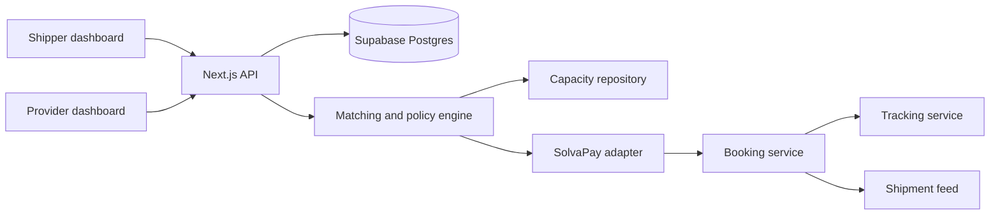

# AutoShip architecture

## System overview

AutoShip is a Next.js TypeScript application with a web client and server-side route handlers. Supabase supplies hosted authentication and Postgres storage. Local development begins with an in-memory repository and switches to the hosted Supabase repository when credentials are supplied. The prototype uses interfaces around matching, payments, tracking, routing, and notifications so deterministic mock implementations can be replaced without changing product flows.

## Components

| Area | Responsibility | Depends on |
| --- | --- | --- |
| `src/app/` | Pages, route handlers, authentication boundaries, theme | Next.js, Supabase Auth |
| `src/components/` | Shared UI: site header, theme toggle, dashboard placeholders | `src/lib/theme/` |
| `src/lib/theme/` | Theme resolution/persistence (`localStorage` key `autoship-theme`) and the inline `<head>` script that applies it before first paint | none |
| `src/features/shipments/` | Form validation, shipment display, manual comparison | shipment service |
| `src/features/providers/` | Capacity listing and provider bookings | capacity service |
| `src/lib/matching/` | Eligibility filters, price/CO₂ calculations, score and ranked matches | shipment and capacity records |
| `src/lib/policy/` | Flag rules, approval and auto-book decisions | organisation policy |
| `src/lib/bookings/` | Atomic reservation, booking lifecycle, receipts | capacity and payment adapters |
| `src/lib/integrations/` | SolvaPay server adapter, payment simulator, routing, tracking, and notification adapters | external services |
| `src/lib/db/` | Supabase queries and organisation access controls | Supabase |
| `tests/` | Unit tests for pure rules and integration tests for flows | application services |

## Data model

- **Account/organisation and user:** Account type is shipper or provider; a shipper account can be business or individual.
- **Shipment:** Description, dimensions, weight, value, cargo handling flags, locations, times, budget, priority, mode and optimisation preferences, and lifecycle status.
- **Capacity listing:** Provider, mode, route, availability, capacity, cargo restrictions, price, CO₂ estimate, and status.
- **Match option:** Shipment and capacity identifiers, calculated price, arrival, deadline margin, CO₂, score, and rank.
- **Policy/approval:** Account-specific automatic price, value, and deadline limits plus approval status and selected option.
- **Booking/tracking:** Reserved capacity, payment state, receipt reference, lifecycle events, and audit metadata.

All account-scoped records include an account identifier. Database row-level security must restrict records to their owner account, except for the controlled matching query that reads available provider listings.

## Important flows

### Autopilot booking

1. A shipper submits validated shipment data; the server persists it as `pending_match`.
2. The matching service filters available capacity and ranks up to three options.
3. The policy service evaluates the chosen option and shipment flags.
4. A flagged result creates an approval request. An unflagged result calls the SolvaPay adapter and books within a transaction that decrements capacity.
5. The booking service writes a receipt reference, a feed event, and initial tracking event.

### Disruption handling

The provider posts a delayed or cancelled tracking event. The server updates ETA or status, re-runs matching, and uses the same policy path to rebook automatically or create an approval request.

## Integrations and MVP substitutions

| Capability | Prototype | Replacement later |
| --- | --- | --- |
| Capacity | Seeded and provider-created listings | Provider databases and freight exchanges |
| Routes and distance | Fixed route distances | OpenRouteService or Google Distance Matrix |
| Payment authorisation/checkout | `@solvapay/server` sandbox; testing adapter fallback | Production SolvaPay configuration |
| Delivery settlement and provider payout | Deterministic simulated adapter | Marketplace-payment provider/Stripe Connect design |
| Tracking | Simulated timeline and map location | Telematics/GPS feed |
| Notifications | In-app feed | Resend email and in-app preferences |
| Imports | Mock connection/import entry point | CSV/Excel, Google Sheets, email, and API intake |

## Runtime and operations

- Local development uses the in-memory repository unless `SUPABASE_URL`, a public Supabase key, and server-only Supabase credentials are present. A hosted Supabase development project is the required integration-test environment; local Docker is not required.
- Task 2 applies migrations to that linked development project using the Supabase CLI through `npx`, then runs a committed database-verification script and integration tests. These checks, rather than SQL review alone, verify migration application, row-level security, and reservation semantics.
- Environment variables contain Supabase and SolvaPay server credentials only; commit an `.env.example` with variable names and no secrets. Service-role and SolvaPay keys must never use a `NEXT_PUBLIC_` prefix.
- Vercel hosts the app and API. Seed scripts create deterministic demo accounts, trips, shipments, factors, and tracking events.
- The MVP starts an Autopilot run on user submission. Scheduled matching and background jobs come after the complete synchronous demo flow is reliable.
- Errors from payment and booking steps must leave no capacity reservation behind.

## Risks and boundaries

- SolvaPay is not an escrow service and does not hold funds. Payment authorisation/checkout and settlement/payout are distinct adapter responsibilities; real marketplace settlement requires a later decision.
- Real payment, carrier, and personal data are not appropriate for demo credentials. Keep them behind adapters and use only sandbox/mock data.
- Multi-leg routing is supported in the data/model design; the first matching implementation may use a single seeded listing per option while retaining a route-leg extension point.
- The no-match and approval states are product outcomes, not errors, and must be demonstrated deliberately with seeded scenarios.
